<p align="center">
  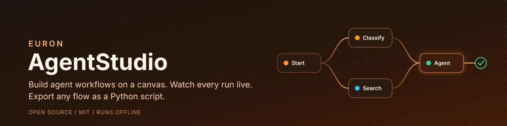
</p>

<p align="center">
  
  <a href="LICENSE"></a>
  
  
  
  
  
  
  
  
</p>

<p align="center">
  <a href="https://github.com/euron-sde-team/euron-agent-studio/stargazers"></a>
  <a href="https://github.com/euron-sde-team/euron-agent-studio/fork"></a>
  <a href="https://github.com/euron-sde-team/euron-agent-studio/watchers"></a>
  <br>
  <a href="https://github.com/euron-sde-team/euron-agent-studio/issues"></a>
  <a href="https://github.com/euron-sde-team/euron-agent-studio/pulls"></a>
  <a href="https://github.com/euron-sde-team/euron-agent-studio/commits/main"></a>
  
  <br>
  <a href="#built-by-the-team-behind-euron"></a>
</p>

<p align="center">
  <b><a href="#-quickstart">Quickstart</a></b> ·
  <b><a href="#️-architecture">Architecture</a></b> ·
  <b><a href="#-explore-the-repository">Explore the repo</a></b> ·
  <b><a href="docs/api/openapi.json">API reference</a></b> ·
  <b><a href="#️-deploy-to-aws">Deploy</a></b> ·
  <b><a href="docs/architecture/security.md">Security</a></b> ·
  <b><a href="#-documentation">Docs</a></b>
</p>

**Euron AgentStudio** is an open-source, MIT-licensed builder for AI agent workflows, part of
the open-source initiative of **ENGAGESPHERE TECHNOLOGY PRIVATE LIMITED**. Draw a flow on a
canvas (prompts, agents with tools, HTTP calls, knowledge search, conditions, loops and human
approvals), run it from the UI, the API or a signed webhook, watch every step stream its
inputs, outputs, latency, tokens and cost live, and export the flow as a standalone Python
script that reproduces it with `httpx`.

It is built for agents that have to work in production, not only in a demo:

- Every run is a trace you can read: each step's inputs, outputs, tokens, cost and tool
  calls, live while it runs and kept afterwards.
- People stay in the loop where it matters: a Human approval step pauses a run until
  someone approves or rejects it, and a paused run holds no worker.
- Flows are data, not code: there is no code node, secrets are write-only and masked in
  every trace, and HTTP steps cannot reach private networks.
- Nothing is locked in: any flow exports as JSON for another deployment, or as a Python
  script you own.

The whole stack runs on a laptop with no API key (a built-in deterministic model runs every
template), against an AWS emulator, and deploys to AWS with one command from the same
Terraform.

<p align="center">
  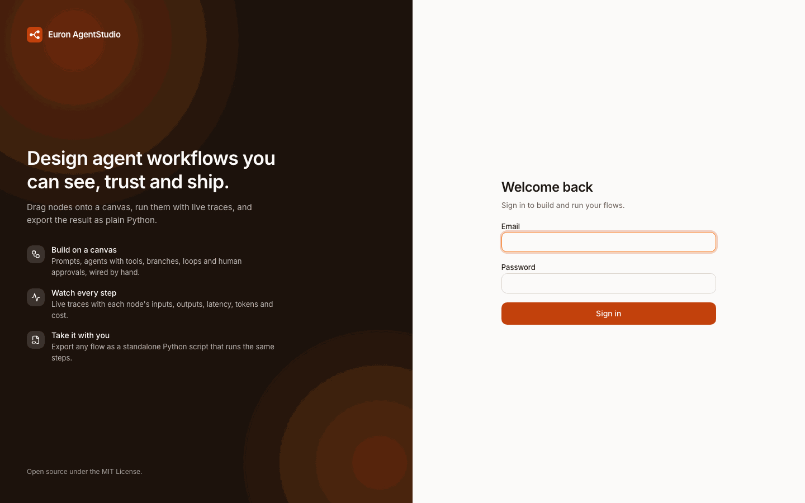
</p>

> [!NOTE]
> Everything in the tour ran for real: Docker Compose on a laptop, with SQS, S3, KMS and
> Secrets Manager emulated locally and provisioned by the same Terraform modules that build
> production. `make up && make demo` reproduces it.

<h3 align="center">Built by the team behind Euron</h3>

<p align="center">Euron AgentStudio comes from the people who build these platforms. If you like how this repository is built, come and see what we build with it.</p>

<p align="center">
  <a href="https://euron.one"><picture><source media="(prefers-color-scheme: dark)" srcset="docs/assets/brand/euron-dark.svg"></picture></a>
  <a href="https://euronsystems.com"><picture><source media="(prefers-color-scheme: dark)" srcset="docs/assets/brand/euron-systems-dark.svg"></picture></a>
  <a href="https://alphaeuron.com"><picture><source media="(prefers-color-scheme: dark)" srcset="docs/assets/brand/alpha-euron-dark.svg"></picture></a>
</p>

<p align="center">
  <a href="https://www.instagram.com/euron_official"></a>
  <a href="https://www.linkedin.com/company/euronone/posts/"></a>
  <a href="https://x.com/euron712"></a>
  <a href="https://www.youtube.com/@Euron-official"></a>
  <a href="https://whatsapp.com/channel/0029VaeeJwq9RZAfPW9P2l07"></a>
</p>

---

## 📚 Table of contents

- [Why Euron AgentStudio](#-why-euron-agentstudio)
- [At a glance](#-at-a-glance)
- [Screenshots](#️-screenshots)
- [Features](#-features)
- [Architecture](#️-architecture)
  - [Life of a run](#life-of-a-run)
  - [Pausing for a person](#pausing-for-a-person)
- [Tech stack](#-tech-stack)
- [Prerequisites](#-prerequisites)
- [Quickstart](#-quickstart)
- [Explore the repository](#-explore-the-repository)
- [API](#-api)
- [Configuration](#️-configuration)
- [Deploy to AWS](#️-deploy-to-aws)
- [Security model](#-security-model)
- [Testing](#-testing)
- [Documentation](#-documentation)
- [Roadmap](#️-roadmap)
- [FAQ](#-faq)
- [Contributing, security and license](#-contributing-security-and-license)

---

## 💡 Why Euron AgentStudio

Agent frameworks make it easy to call a model and hard to see what happened. Hosted
workflow builders make it easy to draw a flow and hard to run it on your own
infrastructure, keep credentials out of logs, or leave. Euron AgentStudio sits between them:
a canvas for the people who design the flow, a real execution engine underneath, and an exit
to plain Python whenever you want one.

- **See every step.** Each run streams its trace live and keeps it: the graph as it ran, a
  timeline with parallel branches and loop iterations, and every step's inputs, outputs,
  tokens, cost, retries and tool calls.
- **Keep people in charge.** Put a Human approval step in front of anything that changes the
  world. The run waits (for days if needed) without holding a worker, and continues on the
  branch the reviewer picks.
- **Safe by construction.** No code nodes: templates, conditions, arithmetic and JSON
  transforms are closed languages. Secrets are encrypted, write-only and masked in every
  trace; HTTP steps cannot reach private networks or cloud metadata.
- **Yours to keep.** Export any flow as JSON for another workspace or deployment, or as a
  standalone Python script that the test suite proves reproduces the engine.
- **Production-grade on AWS in one command.** The Terraform builds the whole stack: VPC,
  RDS, ElastiCache, S3, SQS with a dead-letter queue, KMS, ECS Fargate, the load balancer
  with WAF, alarms. The same modules provision the local emulator.

## 📊 At a glance

| | |
| --- | --- |
| **Apps** | Web app (canvas editor), API, run worker, operator CLI |
| **Node types** | 12: Start, Prompt, Agent, HTTP request, Knowledge search, Calculator, JSON transform, Condition, Loop, Human approval, Output, Note |
| **Triggers** | The editor, workspace API keys (synchronous with `?wait=`), HMAC-signed webhooks, re-runs |
| **Models** | Built-in deterministic offline model (the default), any OpenAI-compatible API, Ollama |
| **Templates** | 6 ready-to-run flows; `make demo` seeds two weeks of real runs from them |
| **Infrastructure** | 12 Terraform modules, 3 environments (local emulator, AWS dev, AWS prod) |
| **Tests** | 255 unit (216 API, 39 web), 73 integration, 22 browser end-to-end, plus a QA crawl of every page at two widths |
| **License** | MIT |

## 🖼️ Screenshots

<table>
  <tr>
    <td width="50%">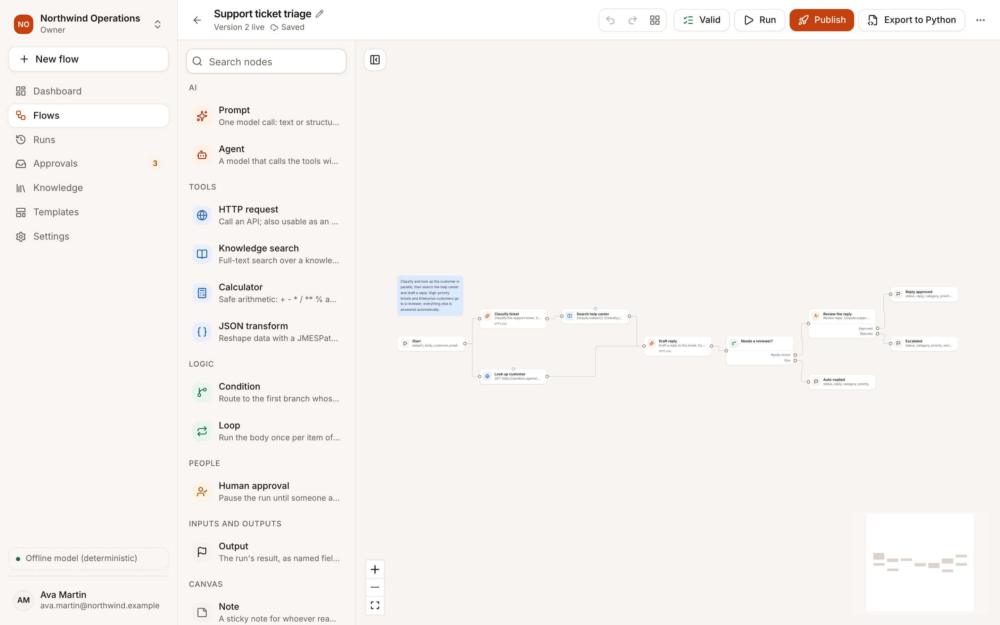<br><sub><b>Canvas editor.</b> Twelve node types, typed connections, inline validation, undo and tidy-up.</sub></td>
    <td width="50%">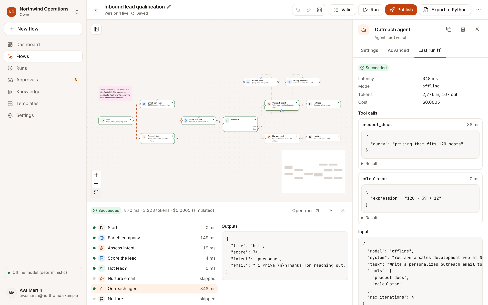<br><sub><b>Live runs.</b> Steps light up as they run; outputs, tokens, cost and tool calls fill in.</sub></td>
  </tr>
  <tr>
    <td>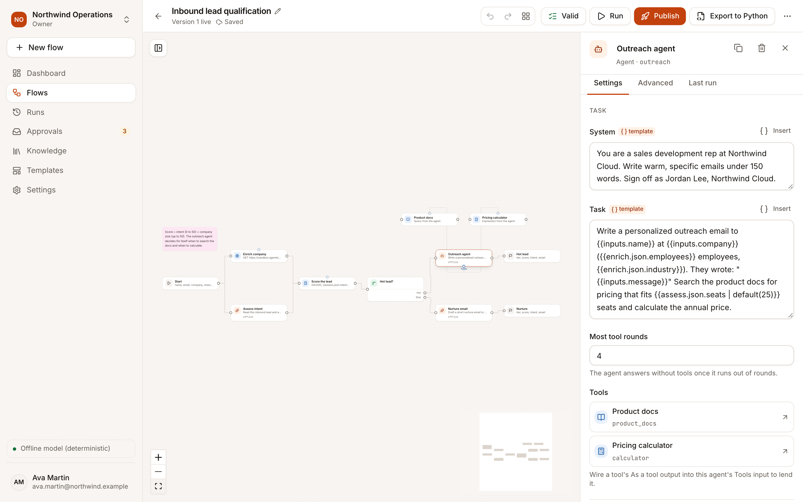<br><sub><b>Agents with tools.</b> An agent calls the knowledge, calculator and HTTP steps wired to it.</sub></td>
    <td>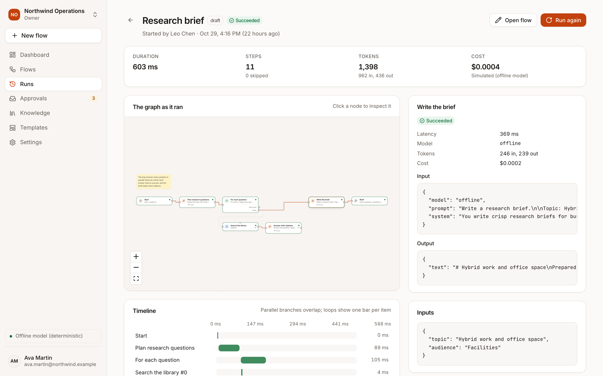<br><sub><b>Run inspector.</b> The graph as it ran, a timeline with loop iterations, every step's data.</sub></td>
  </tr>
  <tr>
    <td>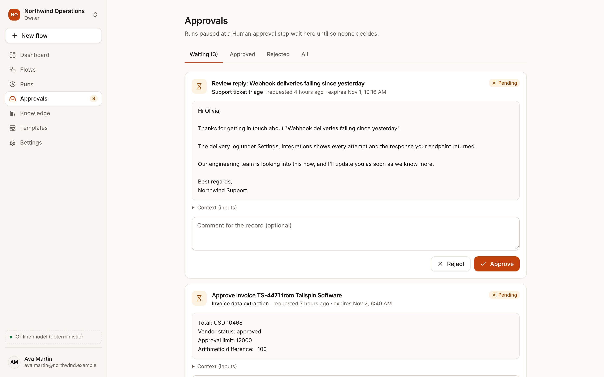<br><sub><b>Approvals.</b> Paused runs wait here; approve or reject with a comment for the record.</sub></td>
    <td>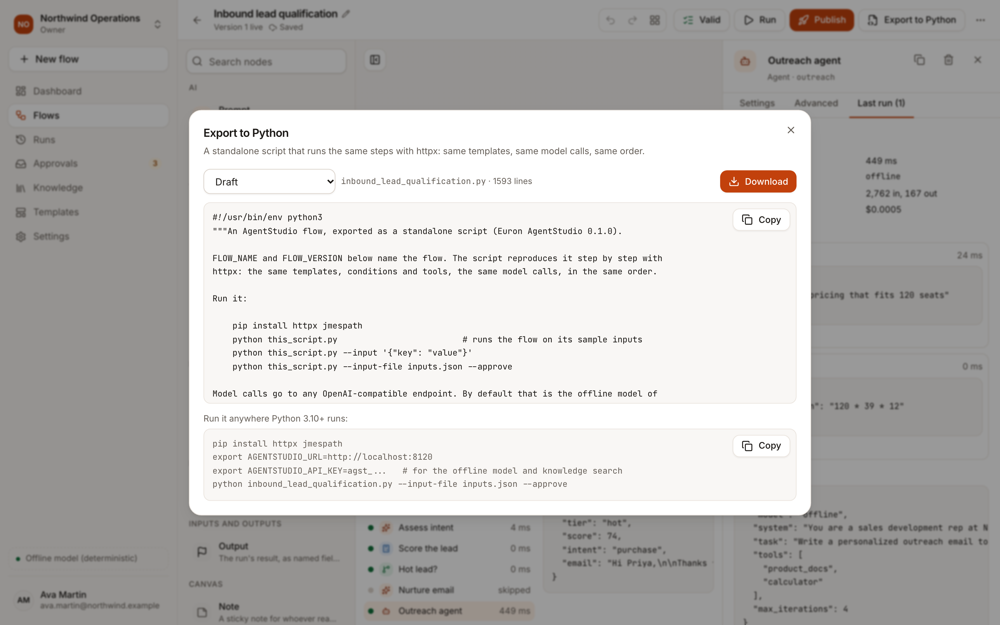<br><sub><b>Export to Python.</b> A standalone script that reproduces the flow with httpx.</sub></td>
  </tr>
  <tr>
    <td>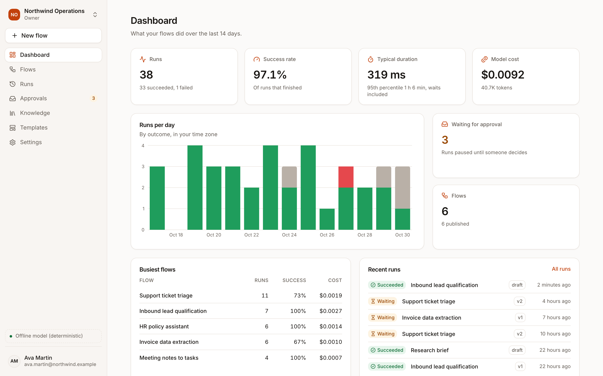<br><sub><b>Dashboard.</b> Runs, success rate, duration percentiles, cost and the busiest flows.</sub></td>
    <td>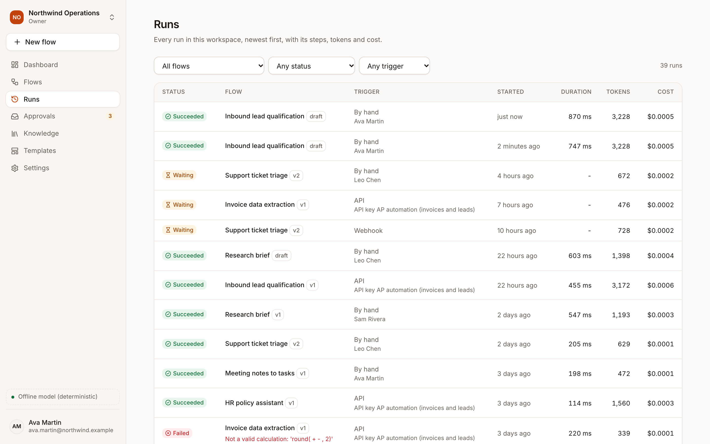<br><sub><b>Run history.</b> Every run with its trigger, duration, tokens and cost, filterable.</sub></td>
  </tr>
  <tr>
    <td>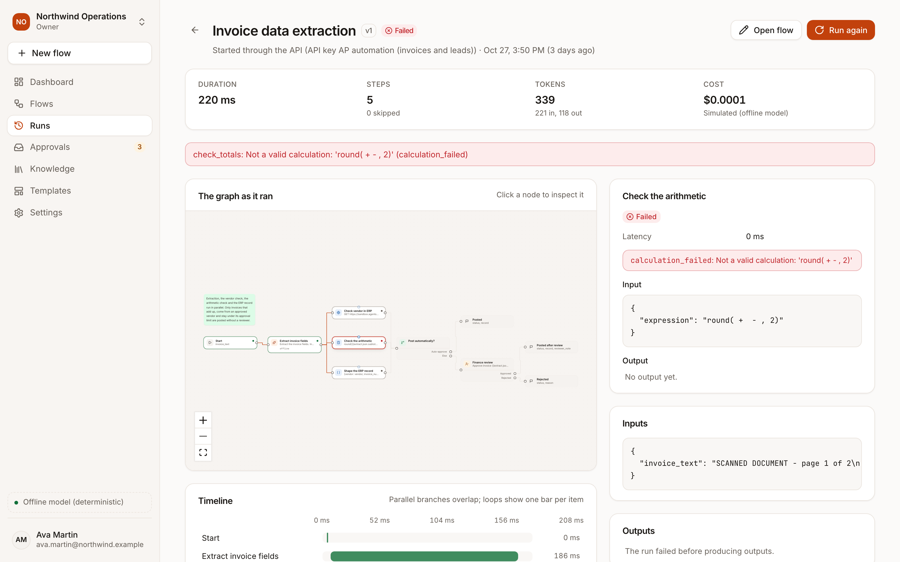<br><sub><b>Failures explained.</b> The failing step, its input and its error, and one click to run again.</sub></td>
    <td>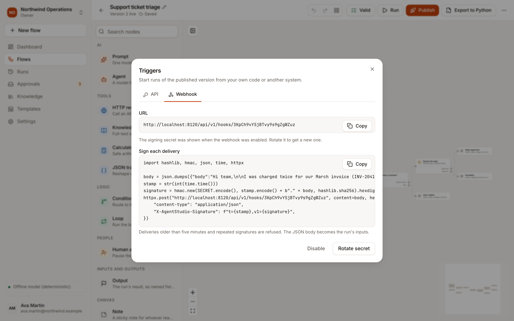<br><sub><b>Triggers.</b> Run the published version from code with an API key or a signed webhook.</sub></td>
  </tr>
  <tr>
    <td>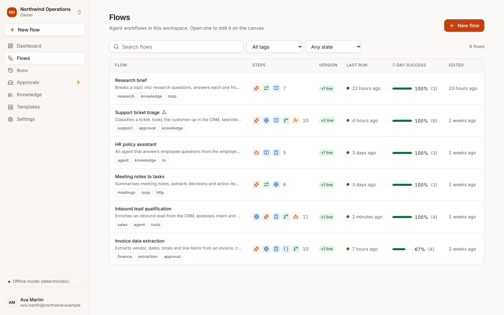<br><sub><b>Flows.</b> Steps, live version, last run and seven-day success at a glance.</sub></td>
    <td>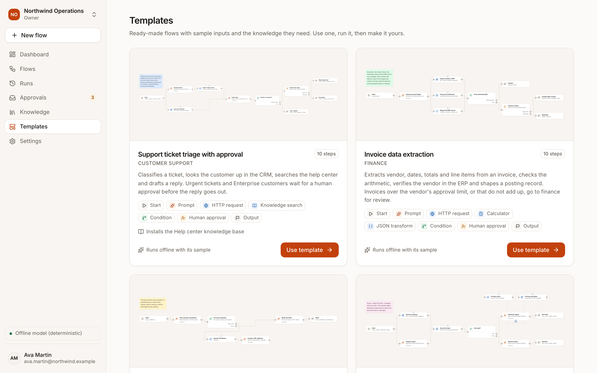<br><sub><b>Templates.</b> Six ready-to-run flows to start from, each with a sample input.</sub></td>
  </tr>
  <tr>
    <td>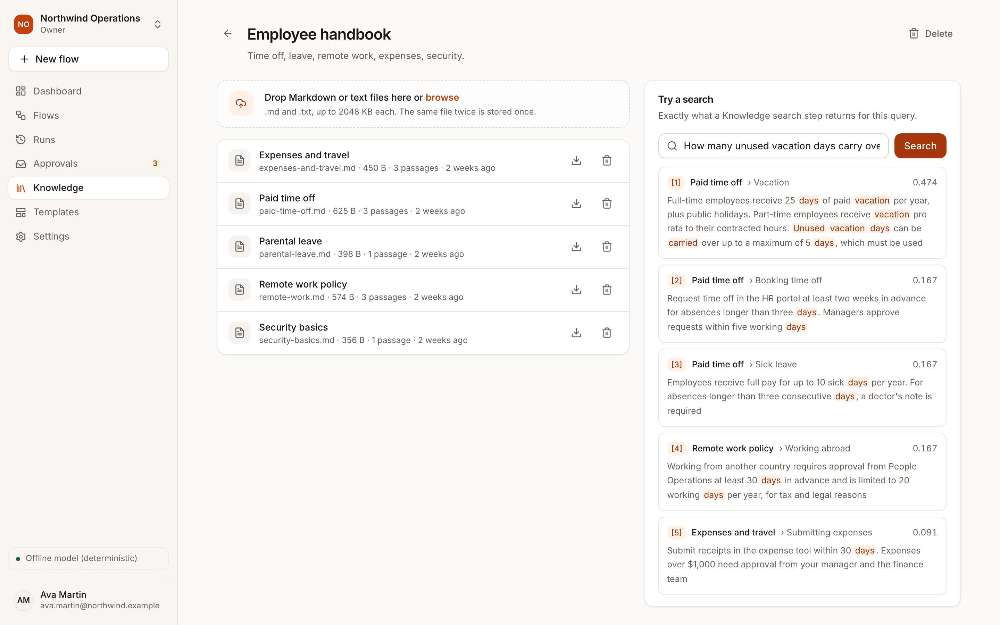<br><sub><b>Knowledge bases.</b> Upload Markdown and text, then search them the way a flow does.</sub></td>
    <td>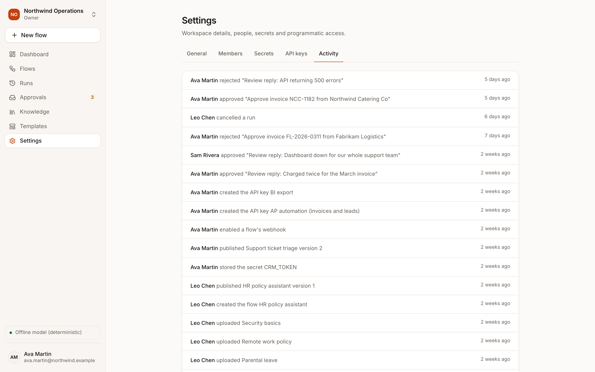<br><sub><b>Activity log.</b> Who changed what: flows, versions, approvals, secrets and keys.</sub></td>
  </tr>
  <tr>
    <td>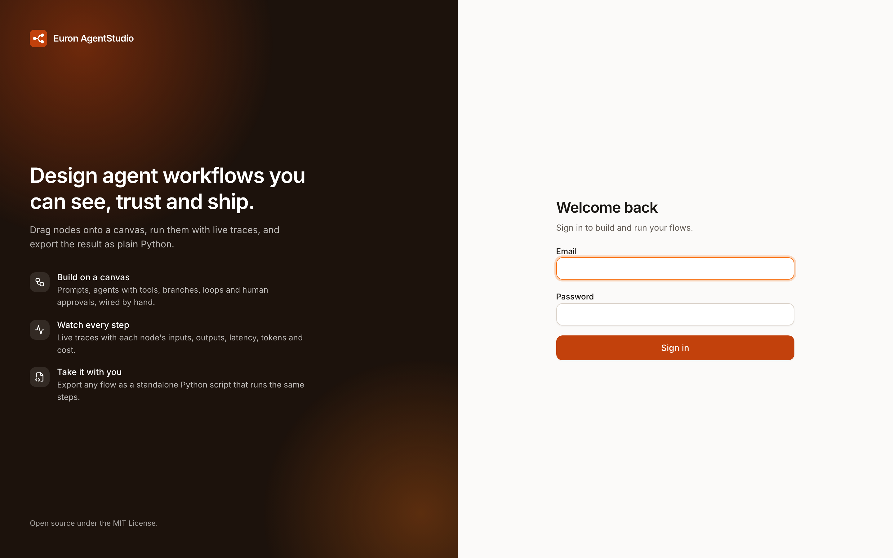<br><sub><b>Sign in.</b> Sessions in an httpOnly cookie, lockout after repeated failures.</sub></td>
    <td>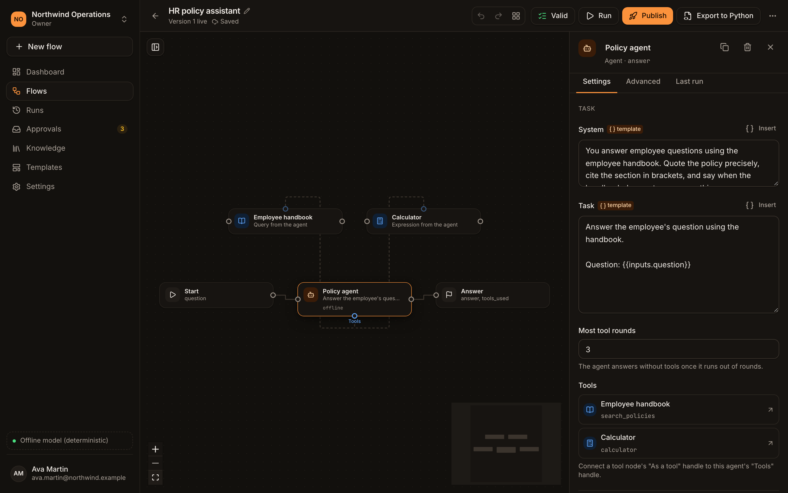<br><sub><b>Dark theme.</b> Follows the system setting, switchable from the account menu.</sub></td>
  </tr>
</table>

## ✨ Features

| Area | What you get |
| --- | --- |
| **Canvas editor** | A searchable palette with drag and drop, typed handles and connection rules, an inspector with a form per node type, a `{{` reference picker that lists exactly what a step can see, inline validation (counts on nodes, red edges, messages under fields), undo and redo, one-click layout, notes, autosave with revision checks, dark theme |
| **Nodes** | Prompt (text, or JSON with declared fields), Agent (tool calling over the steps wired to it), HTTP request (headers, JSON or text bodies, status handling), Knowledge search, Calculator, JSON transform (JMESPath), Condition (named routes with all or any rules, and an else), Loop (over a list, several items at a time), Human approval (title, message, deadline), Output, Note |
| **Engine** | DAG execution with parallel branches, skip propagation and merges; per-step timeouts and retries with back-off and jitter; continue on error; run timeouts; cancellation within half a second; pause and resume; secrets masked and payloads capped in everything recorded |
| **Runs and traces** | Live server-sent events from Redis streams, resumable with `Last-Event-ID`; a run inspector with the graph as it ran and a timeline; history filtered by flow, status and trigger; re-runs; tokens and cost per step and per run |
| **Triggers** | The editor (the draft or a version), workspace API keys with `?wait=` for synchronous callers, HMAC-signed webhooks with replay protection; production triggers run published versions |
| **Approvals** | An inbox of waiting, approved and rejected requests; comments; deadlines that expire into the rejected branch; decided by people, never by API keys |
| **Models** | The offline model (classification, extraction, summaries, drafting and tool calls, deterministic), any OpenAI-compatible API and Ollama behind one interface; a model per step and a default per workspace; a per-workspace response cache; a price table you can override |
| **Knowledge** | Knowledge bases of Markdown and text, deduplicated by content, chunked and searched with PostgreSQL full text; originals in S3 with SSE-KMS |
| **Versions and export** | Publish, version history, restore into the draft; JSON export and import across workspaces and deployments; Python export |
| **Workspaces** | Owners, editors and viewers; members added with a temporary password they replace; write-only secrets; API keys with expiry; an activity log; a dashboard |
| **Operations** | Health and readiness probes, Prometheus metrics, JSON logs with request ids, an SQS worker with heartbeats, a reaper for lost workers and lost messages, a dead-letter queue, graceful hand-back on deploys |

## 🏗️ Architecture

<p align="center">
  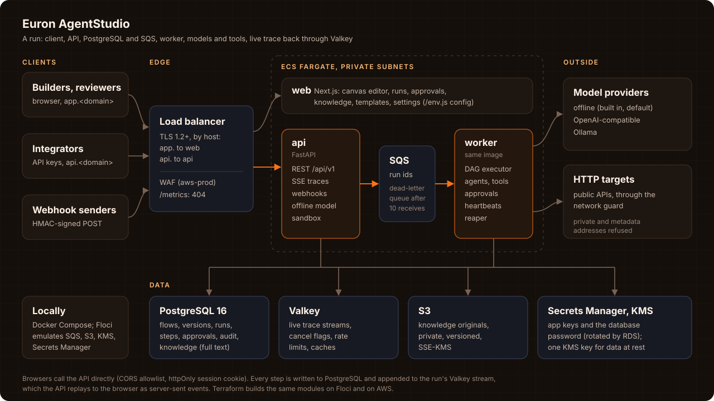
</p>

Three services run on ECS Fargate from two images; the web app and the API sit behind one
Application Load Balancer, and the worker has no inbound path at all:

- **web** (`app.<domain>`): the Next.js app with the React Flow canvas. One image for every
  environment; it reads the API address at run time from `/env.js`.
- **api** (`api.<domain>`): the FastAPI service: auth, workspaces, flows and versions, runs
  and live traces, approvals, knowledge, secrets, API keys and webhooks. It stores each run
  in PostgreSQL and puts its id on SQS.
- **worker** (the API image, another command): claims runs from SQS with a conditional
  update, executes the graph, records every step, and hands runs back when it stops.

[HLD](docs/architecture/HLD.md) · [LLD](docs/architecture/LLD.md) · [Data model](docs/architecture/data-model.md) · [Decision records](docs/architecture/adr/README.md)

### Life of a run

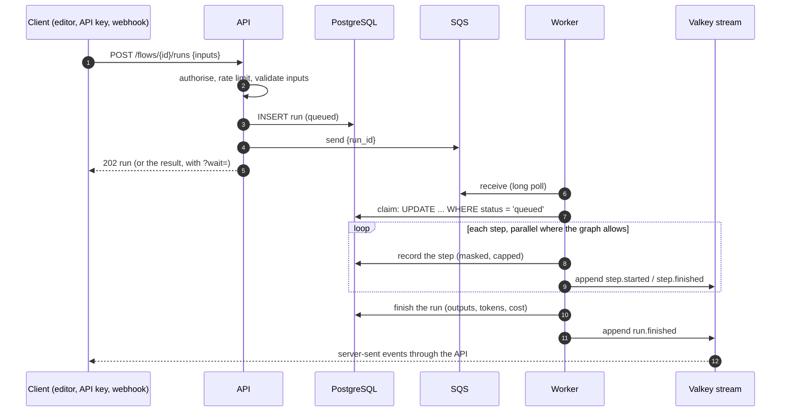

### Pausing for a person

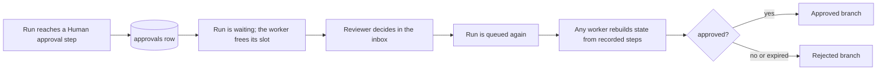

The API layers each have one job:

| Layer | Folder | Job |
| --- | --- | --- |
| Routes | `apps/api/src/agentstudio/api/routes/` | URL, auth dependency, role check, nothing else |
| Services | `apps/api/src/agentstudio/services/` | Business rules, transactions, cache invalidation, activity entries |
| Repositories | `apps/api/src/agentstudio/repositories/` | The only database access; every query is scoped to a workspace |
| Engine | `apps/api/src/agentstudio/engine/` | Graph models, validation, planning, the expression runtime, the executor, node handlers |
| Providers | `apps/api/src/agentstudio/providers/` | The model interface, the offline model, OpenAI-compatible and Ollama adapters, pricing |

Read more: [security](docs/architecture/security.md) · [threat model](docs/architecture/threat-model.md)

## 🧰 Tech stack

| Layer | Choice | Why |
| --- | --- | --- |
| API | Python 3.12, FastAPI, Pydantic v2, SQLAlchemy 2 (async), Alembic | Typed end to end, native server-sent events, one codebase for the API, the worker and the CLI ([ADR 0002](docs/architecture/adr/0002-one-api-image-three-roles.md)) |
| Engine | An async DAG executor with a closed expression language (templates, RE2 conditions, an AST calculator, JMESPath) | Flows compute without running user code ([ADR 0010](docs/architecture/adr/0010-a-closed-expression-language-instead-of-code-nodes.md)) |
| Data | PostgreSQL 16 (JSONB graphs, full-text search) | One transactional store for flows, runs, steps and knowledge ([ADR 0001](docs/architecture/adr/0001-the-graph-document-is-the-source-of-truth.md)) |
| Queue | SQS with a dead-letter queue, conditional claims in PostgreSQL | Runs survive duplicates, crashes and deploys ([ADR 0003](docs/architecture/adr/0003-sqs-run-queue-with-postgres-claims.md)) |
| Live traces | Valkey (Redis-compatible) streams over server-sent events | Late and reconnecting browsers miss nothing ([ADR 0005](docs/architecture/adr/0005-redis-streams-for-run-traces.md)) |
| Models | Offline deterministic model, OpenAI-compatible, Ollama | Everything works with no key; real models are a setting ([ADR 0006](docs/architecture/adr/0006-deterministic-offline-provider.md)) |
| Web | Next.js 16, React 19, React Flow 12, Tailwind 4, TanStack Query 5, Radix primitives, dagre | A fast, accessible editor with one image for every environment |
| AWS | ECS Fargate (ARM64), ALB, WAF, RDS, ElastiCache, S3, SQS, KMS, Secrets Manager, CloudWatch | Managed building blocks, least-privilege roles |
| Infrastructure as code | Terraform | The same modules build AWS and the local emulator ([ADR 0004](docs/architecture/adr/0004-floci-for-local-aws.md)) |
| Tests | pytest, Vitest, Playwright with axe | Unit, integration against real PostgreSQL, Valkey and emulated AWS, browser end-to-end and QA |

## 📋 Prerequisites

| Tool | Version | Used for |
| --- | --- | --- |
| [Docker](https://docs.docker.com/get-docker/) with Compose v2 | 24+ | The local stack |
| [uv](https://docs.astral.sh/uv/) | 0.13+ | The API's Python environment, outside Docker |
| [Node.js](https://nodejs.org/) | 22 LTS | The web app and the browser tests, outside Docker |
| [pnpm](https://pnpm.io/) | 9 (`corepack enable`) | The JavaScript workspace |
| [Terraform](https://developer.hashicorp.com/terraform/install) | 1.10+ | Only for deploying to AWS (local runs use a pinned container) |
| [AWS CLI](https://aws.amazon.com/cli/) | 2 | Only for deploying to AWS |

Free local ports (each overridable in `deploy/compose/.env`): 3120 (web), 8120 (API), 5452
(PostgreSQL), 6412 (Valkey), 4612 (AWS emulator), 9120 (worker metrics).

## 🚀 Quickstart

```bash
git clone https://github.com/euron-sde-team/euron-agent-studio.git
cd euron-agent-studio

make up      # build and start everything; Terraform provisions the AWS emulator first
make demo    # four people, six flows from the templates, two weeks of real runs
```

| Open | As |
| --- | --- |
| http://localhost:3120 | `ava.martin@northwind.example` (owner of Northwind Operations), `leo.chen@northwind.example` (editor) or `maya.patel@northwind.example` (viewer) |
| http://localhost:8120/docs | The interactive API reference |

The password for every demo account is printed by `make demo` (it is generated by `make env`
and stored in `deploy/compose/.env`). Open *Support ticket triage*, press **Run**, and watch
the steps light up; the run pauses for approval, which you give from **Approvals**.
`make down` stops everything and deletes the data.

To use a real model, set `OPENAI_BASE_URL` and `OPENAI_API_KEY` (any OpenAI-compatible API)
or `OLLAMA_URL` in `deploy/compose/.env`, then `make up`; the models appear in every step's
model picker next to `offline`.

[Full local guide](docs/guides/quickstart-local.md) ·
[Guided walkthrough](docs/guides/walkthrough.md) ·
[Troubleshooting](docs/guides/troubleshooting.md)

## 🧭 Explore the repository

```text
euron-agent-studio/
├── apps/
│   ├── api/                     FastAPI service, run worker and CLI (one package)
│   │   ├── src/agentstudio/
│   │   │   ├── api/                 routes and request dependencies
│   │   │   ├── services/            business rules: auth, workspaces, flows, runs, approvals
│   │   │   ├── repositories/        all database access, scoped to a workspace
│   │   │   ├── engine/              graph models, validation, planning, runtime, executor, nodes
│   │   │   ├── providers/           model interface, offline model, OpenAI-compatible, Ollama
│   │   │   ├── export/              the Python exporter
│   │   │   ├── integrations/        SQS, S3, trace streams, guarded HTTP, the sandbox API
│   │   │   ├── templates/ demo/     the template gallery and the demo seed
│   │   │   ├── models/ schemas/     tables and API shapes
│   │   │   ├── db/ migrations/      engine, sessions, advisory-locked migrations
│   │   │   ├── core/                config, errors, logging, security, crypto, rate limits, metrics
│   │   │   ├── worker.py            the SQS worker
│   │   │   └── cli.py               migrate, users, demo seed, OpenAPI export
│   │   └── tests/                   unit and integration suites
│   └── web/                     Next.js app: canvas editor, runs, approvals, knowledge, settings
├── infra/
│   ├── terraform/               modules + envs (local-floci, aws-dev, aws-prod)
│   └── docker/                  api and web images
├── deploy/compose/              the local stack (Floci or real AWS overlay)
├── e2e/                         Playwright: journeys, the QA crawl, screenshots and the tour
├── docs/                        architecture, ADRs, guides, OpenAPI
└── scripts/                     deploy, one-off tasks, local env, test services, sanitization
```

**Where to start reading:**

| To understand | Read |
| --- | --- |
| How a run executes | `engine/executor.py`, then `engine/nodes.py` and `engine/runtime.py` |
| How a run travels | `services/runs.py` (`RunService.start`, `RunExecution`), then `worker.py` |
| How live traces work | `integrations/trace.py`, `services/events.py`, then `apps/web/src/lib/trace.ts` |
| How approvals pause and resume | `services/approvals.py`, then `resume_state` in `services/runs.py` |
| How the canvas edits a flow | `apps/web/src/components/editor/editor.tsx`, `apps/web/src/lib/graph.ts` |
| How workspaces are isolated | `api/deps.py` (`WorkspaceAccess`) and `repositories/`, then `tests/integration/test_isolation.py` |
| How exports stay faithful | `export/python.py`, then `tests/unit/test_export.py` |
| How it deploys | `infra/terraform/modules/deployment/main.tf`, then `scripts/aws-deploy.sh` |

Paths in the second column are under `apps/api/src/agentstudio/` unless they start with
`apps/`, `tests/`, `infra/` or `scripts/`. The [walkthrough](docs/guides/walkthrough.md)
follows one support ticket from a webhook to an approved reply through the code.

## 🔌 API

The [OpenAPI reference](docs/api/openapi.json) is exported from the application itself
(`make openapi`), so it always matches the code, and the running API serves it interactively
at `/docs`. Start a run from your own code with a workspace API key, and wait for the result:

```bash
curl -s "localhost:8120/api/v1/workspaces/northwind-operations/flows/$FLOW_ID/runs?wait=30" \
  -H "authorization: Bearer $AGENTSTUDIO_API_KEY" -H 'content-type: application/json' \
  -d '{"inputs": {"subject": "Refund please", "body": "I was charged twice.", "customer_email": "dana@globex.example"}}' \
  | jq '.status, .outputs'
```

`GET .../runs/{run_id}/events` streams the same run as server-sent events. Errors always have
the shape `{"error": {"code", "message", "request_id"}}` and every response carries an
`X-Request-Id` header. The [API guide](docs/api/README.md) covers authentication,
pagination, webhooks and exports.

## ⚙️ Configuration

The API reads its configuration from the environment. With `APP_ENV=production` it refuses to
boot, listing every problem at once, unless:

- the session secret and the API key pepper are random, at least 32 characters and different,
  and the encryption key is 32 random bytes
- cookies are secure and CORS names the web app's origins
- knowledge files go to S3 and runs go through SQS, with no emulator endpoint configured
- flows cannot reach private networks wholesale (individual hosts can be allowed)

The web app reads `API_URL` and `PRODUCT_NAME` at run time from `/env.js`, so one image serves
every environment. Every variable is documented in the
[configuration reference](docs/guides/configuration.md).

## ☁️ Deploy to AWS

```bash
cp infra/terraform/envs/aws-dev/terraform.tfvars.example infra/terraform/envs/aws-dev/terraform.tfvars
# set name_prefix, domain and route53_zone_id

make aws-deploy ENV=aws-dev       # registries, images, infrastructure, rollout
make aws-cli ENV=aws-dev ARGS="user create --email you@example.com --name 'You' --admin"
```

`aws-deploy` runs four steps:

1. Create the image registries.
2. Build and push the API and web images for ARM64, tagged with the git commit.
3. Apply the rest of the infrastructure.
4. Wait for the API, worker and web services to stabilise.

Migrations run when the API boots, under an advisory lock. The database password never
appears in a task definition: the API and the worker read it from the RDS-managed secret for
each new connection, so a rotation needs no redeploy. Workers get two minutes to hand their
runs back on every deploy.

| | aws-dev | aws-prod |
| --- | --- | --- |
| Availability zones | 2, one NAT | 3, NAT per zone, VPC interface endpoints |
| Database | single-AZ, 3-day backups | Multi-AZ, 14-day backups, deletion protection |
| Cache | one Valkey node | primary and replica |
| Edge | load balancer | load balancer with AWS WAF managed rules and rate limiting |
| Scaling | API 1 to 2, worker 1 to 2, web 1 to 2 | API 2 to 6, worker 2 to 8, web 2 to 6 |
| Logs | 14 days | 365 days, KMS-encrypted |

[Deployment guide](docs/guides/deploy-aws.md) · [Operations](docs/guides/operations.md)

## 🔐 Security model

| Concern | How it is handled |
| --- | --- |
| Workspace isolation | Every query is scoped to the caller's workspace; non-members get 404, not 403; an integration sweep calls every workspace endpoint as an outsider and with another workspace's key |
| Code execution | None: no code nodes; templates, conditions (RE2), arithmetic (an AST walker) and transforms (JMESPath) are closed languages; exported scripts embed user text only as literals |
| Secrets | AES-256-GCM, bound to their workspace and name; write-only through the API; masked as `[secret:NAME]` in steps, events, outputs and errors |
| Outbound requests | HTTP steps resolve and check every address at connect time: loopback, private, link-local, shared and metadata ranges are refused unless a host is allowed |
| Sessions | Argon2id passwords, lockout and per-IP throttling, signed sessions with a per-user version (a password change signs out every other session) and a revocation list for sign-out |
| Cookies and CSRF | HttpOnly, SameSite=Lax cookies; any write with a cookie must come from the web app's origin |
| API keys and webhooks | `agst_` keys scoped to one workspace and role, shown once, stored as a peppered HMAC; webhooks signed with HMAC-SHA256, time-boxed and protected against replays |
| Prompt injection | Agents act only through the tools wired to them, those tools cannot reach private networks, and an approval can gate any action. This narrows injection; it is not a boundary |
| Infrastructure | Private subnets, TLS everywhere, one KMS key for data at rest, least-privilege task roles, read-only containers, checkov with justified exceptions only |

Report vulnerabilities privately: see [SECURITY.md](SECURITY.md).

## 🧪 Testing

| Suite | What it proves | Run |
| --- | --- | --- |
| Unit (255) | The executor (parallelism, loops, retries, timeouts, pause and resume, masking), validation, the expression runtime, the offline model, providers, the network guard, every template, the exporter (every template's script reproduces the engine), editor logic | `make test` |
| Integration (73) | The real API against PostgreSQL, Valkey and the AWS emulator: auth, roles, flows and versions, runs and live traces, approvals, knowledge on S3, secrets, webhooks, the SQS worker under duplicates, crashes and lost messages, an isolation sweep | `make test-integration` |
| Browser (22) | Building and running a flow on the canvas, live traces, approvals, failures and re-runs, exports and imports, knowledge, settings, roles, templates | `make e2e` |
| QA crawl | Every page at desktop and mobile widths: no console errors, failed requests, broken links or serious accessibility violations | `make qa` |
| Infrastructure | `terraform validate` (3 environments), tflint, checkov | `make tf-validate tf-lint tf-security` |

The API suites cover 81% of the `agentstudio` package, branches included.
[Testing guide](docs/guides/testing.md)

## 📖 Documentation

| Architecture | Guides |
| --- | --- |
| [High-level design](docs/architecture/HLD.md) | [Quickstart (local)](docs/guides/quickstart-local.md) |
| [Low-level design](docs/architecture/LLD.md) | [Guided walkthrough](docs/guides/walkthrough.md) |
| [Data model](docs/architecture/data-model.md) | [Configuration reference](docs/guides/configuration.md) |
| [Security](docs/architecture/security.md) | [Deploy to AWS](docs/guides/deploy-aws.md) |
| [Threat model](docs/architecture/threat-model.md) | [Local containers on real AWS](docs/guides/local-with-aws.md) |
| [Decision records](docs/architecture/adr/README.md) | [Operations](docs/guides/operations.md) |
| [API reference (OpenAPI)](docs/api/openapi.json) · [API guide](docs/api/README.md) | [Testing](docs/guides/testing.md) · [Troubleshooting](docs/guides/troubleshooting.md) |

## 🗺️ Roadmap

- Scheduled triggers (cron)
- Token-by-token streaming of model output into live traces
- Semantic search for knowledge bases, next to full text
- Secrets scoped to flows, and spend budgets per workspace
- Single sign-on (OIDC, SAML) and two-factor authentication
- A four-eyes option for approvals

Have an idea? [Open a feature request](https://github.com/euron-sde-team/euron-agent-studio/issues/new/choose).

## ❓ FAQ

<details>
<summary><b>Do I need an OpenAI key or a GPU?</b></summary>

No. Every template runs on the built-in offline model, which classifies, extracts,
summarises, drafts and calls tools deterministically, on a CPU, with no network. Point a step
at any OpenAI-compatible API or at Ollama when you want a real model; nothing else in the
flow changes.
</details>

<details>
<summary><b>What is the offline model, really?</b></summary>

A provider that reads the request (instructions, schema, tools) and answers with plain
heuristics: it fills JSON fields from the text, picks labels the prompt names, writes
templated replies and chooses tools by their descriptions. It is not intelligent and is
labelled "Offline" everywhere, but it makes demos, tests and exported scripts reproducible
to the byte.
</details>

<details>
<summary><b>Can a flow run arbitrary code?</b></summary>

No, by design. Computation goes through templates, conditions, a calculator and JMESPath
transforms; the only way out of the worker is the HTTP step, behind the network guard. When
you need code, export the flow to Python and change the script, or call a service you own
from an HTTP step.
</details>

<details>
<summary><b>What happens if a worker dies in the middle of a run?</b></summary>

The run stops heartbeating, and within about two minutes the reaper hands it to another
worker, which resumes from the last finished step. A run whose queue message is lost is sent
again after five minutes. Deploys are gentler still: a stopping worker lets runs finish, then
hands the rest back at once.
</details>

<details>
<summary><b>Does exported Python behave exactly like AgentStudio?</b></summary>

For the logic, yes: the script embeds the engine's own expression runtime, and the test
suite runs every template's export and compares its outputs with the engine's. Live traces,
versions and the approvals inbox stay in AgentStudio; the script prints its results and asks
for approvals on the terminal.
</details>

<details>
<summary><b>Can it run outside AWS?</b></summary>

Yes. The API also supports local disk storage and an in-process run queue, so it runs
anywhere with PostgreSQL and Redis or Valkey. The Terraform targets AWS.
</details>

## 🤝 Contributing, security and license

Contributions are welcome: read [CONTRIBUTING.md](CONTRIBUTING.md) and the
[code of conduct](CODE_OF_CONDUCT.md). Report security issues privately as described in
[SECURITY.md](SECURITY.md). Notable changes are listed in the [changelog](CHANGELOG.md).

Released under the [MIT License](LICENSE). Copyright (c) 2026 ENGAGESPHERE TECHNOLOGY
PRIVATE LIMITED and the Euron AgentStudio contributors.

<p align="center">
  If Euron AgentStudio saves you time, <b><a href="https://github.com/euron-sde-team/euron-agent-studio/stargazers">⭐ star the repository</a></b>.
</p>
