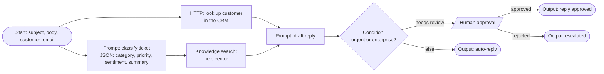
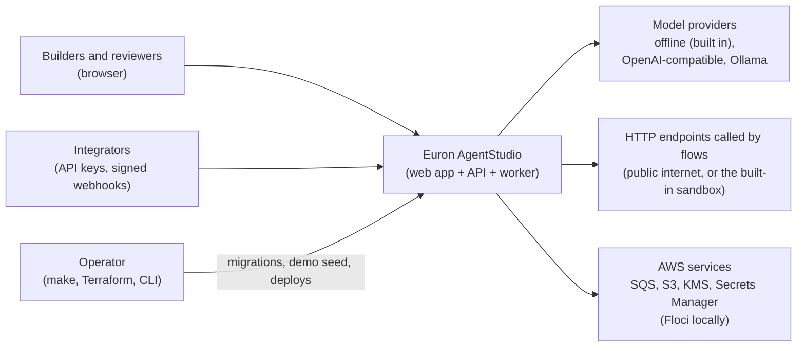
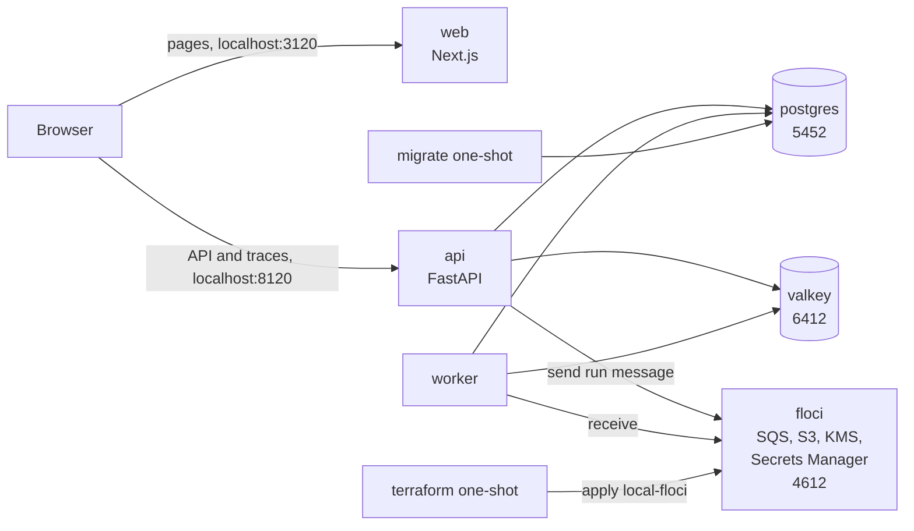
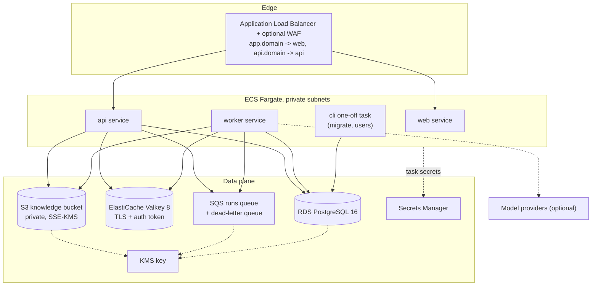
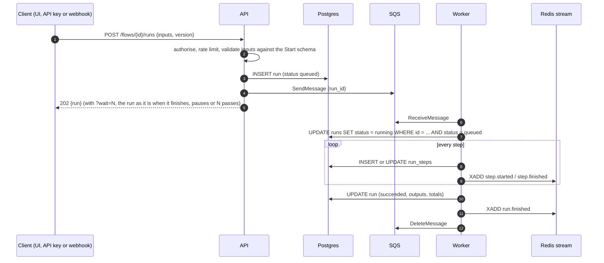
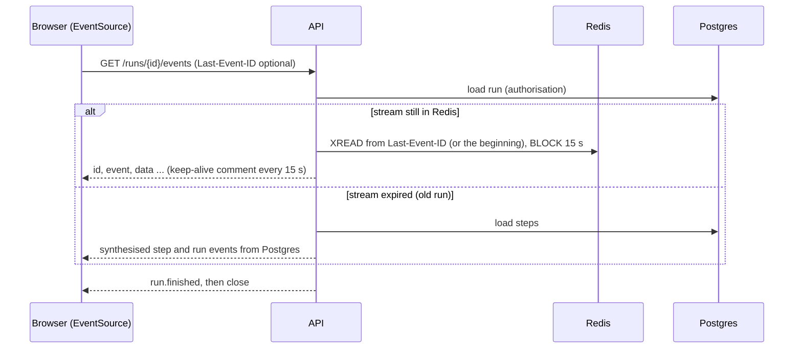

# High-level design

Euron AgentStudio is a self-hosted builder for AI agent workflows. People draw a flow on a
canvas (prompts, agents with tools, HTTP calls, knowledge search, branches, loops and
human approvals), run it from the UI, the API or a signed webhook, watch every step stream
its inputs, outputs, latency, tokens and cost live, and export the flow as a standalone
Python script that reproduces it with `httpx`.

This page describes the product and the system as built: what runs, where data lives, how
a run travels and what happens when a piece fails. Deeper topics have their own pages:

| Topic | Page |
| --- | --- |
| Modules, layers, the graph format, the engine and the exporter | [LLD.md](LLD.md) |
| Tables, constraints, indexes, Redis keys and queue messages | [data-model.md](data-model.md) |
| Security controls and known limitations | [security.md](security.md) |
| STRIDE analysis | [threat-model.md](threat-model.md) |
| Decisions and their trade-offs | [adr/](adr/README.md) |

All code paths are relative to the repository root.

## 1. The product

### 1.1 Who uses it

| Person | What they do |
| --- | --- |
| **Builder** (workspace editor or owner) | Designs flows on the canvas, tests them with sample inputs, publishes versions, wires webhooks, manages knowledge bases and secrets |
| **Reviewer** (editor or owner) | Approves or rejects runs paused at a Human approval step, from the approvals inbox |
| **Viewer** | Reads flows, runs and traces; cannot change or start anything |
| **Integrator** (an API key or a webhook sender) | Starts runs of published flows from other systems and reads their results |
| **Operator** | Deploys and runs AgentStudio: Docker Compose locally, Terraform on AWS, the `agentstudio` CLI |

### 1.2 Concepts

| Concept | Meaning |
| --- | --- |
| **Workspace** | The tenant boundary. Members have one role each: `owner`, `editor` or `viewer`. Everything below belongs to exactly one workspace. |
| **Flow** | A named workflow. It always has an editable **draft** graph and zero or more immutable **versions**. |
| **Version** | A published snapshot of the draft (`v1`, `v2`, ...). Webhooks and API callers run the published version; the editor can also run the draft. |
| **Graph** | The JSON document a flow is made of: nodes (type, position, configuration) and edges (source handle to target handle). Import and export use the same document. |
| **Node** | One step: Start, Prompt (LLM), Agent, HTTP request, Knowledge search, Calculator, JSON transform, Condition, Loop, Human approval, Output, plus Note (canvas annotation, never executed). |
| **Run** | One execution of a flow version (or of the draft) with given inputs. Durable in Postgres, queued on SQS, executed by a worker. |
| **Step** | One node's execution inside a run (one per loop iteration for nodes inside a loop), with its inputs, outputs, latency, tokens, cost, attempts and tool calls. |
| **Approval** | A request created when a run reaches a Human approval node. The run pauses until someone approves or rejects it. |
| **Knowledge base** | A collection of uploaded text and Markdown documents, chunked and indexed with Postgres full-text search, queried by Knowledge search nodes. |
| **Secret** | A named credential stored encrypted (AES-256-GCM), referenced in node settings as `{{secrets.NAME}}`, never returned by the API and masked in every trace. |
| **Template** | A ready-made flow from the gallery. Creating a flow from a template copies its graph into a new draft. |

### 1.3 What a flow looks like

The *Support ticket triage* template, as drawn on the canvas:

`classify` and `crm` run in parallel; `draft` waits for both branches. When the run
reaches `approve` it pauses, an approval appears in the inbox, and the run continues on the
branch the reviewer chooses.

### 1.4 Scope

In scope for this release: everything above, three model providers (the built-in offline
provider, any OpenAI-compatible endpoint, and Ollama), the Python exporter, five or more
templates, workspaces with roles, API keys, webhooks, secrets, an audit log, a dashboard,
and the full local and AWS deployment.

Out of scope (see the roadmap in the README): schedules (cron triggers), token-by-token
streaming of model output into traces, arbitrary code nodes, multi-region deployment,
single sign-on.

## 2. System context

- The **offline provider** runs in process. It needs no network and no key, so every flow,
  test, demo and screenshot works on a laptop with the network unplugged.
- **HTTP request nodes** reach the public internet through a guarded client that refuses
  private, loopback, link-local and metadata addresses. Requests to the reserved host
  `sandbox.agentstudio.test` are answered in process by the **sandbox API**, a small set of
  fixture endpoints (CRM, ERP, task tracker, exchange rates) that the templates use so they
  run offline.

## 3. Containers

The repository builds two images. The API image carries three entry points.

| Container | Source | Listens | Role |
| --- | --- | --- | --- |
| Web app | `apps/web` (Next.js, standalone) | 8080 (host 3120) | The canvas editor, runs, approvals, knowledge, templates, settings. Serves `/env.js` with the runtime configuration (the API URL), so one image serves every environment. The browser calls the API directly, with the session cookie, under a strict CORS allowlist. |
| API | `apps/api/src/agentstudio/main.py` | 8080 (host 8120) | REST under `/api/v1`, server-sent events for run traces, webhooks under `/api/v1/hooks`, the OpenAI-compatible offline model under `/api/v1/offline/v1`, the sandbox under `/sandbox`, probes and metrics. |
| Worker | `apps/api/src/agentstudio/worker.py` | metrics on 9100 (host 9120) | Long-polls SQS, executes runs with bounded concurrency, heartbeats, re-queues runs whose worker vanished and expires approvals. |
| Migrate (one-off) | `agentstudio migrate` | none | Applies Alembic migrations under a Postgres advisory lock, then exits. |
| Terraform (one-off, local) | `hashicorp/terraform` | none | Applies `infra/terraform/envs/local-floci` to the emulator before anything that needs AWS starts. |

Backing services: PostgreSQL 16, Valkey 8 (Redis-compatible), and locally the Floci emulator
for SQS, S3, KMS and Secrets Manager.

### 3.1 Local shape (`make up`)

### 3.2 Deployed shape (AWS)

`envs/aws-dev` and `envs/aws-prod` call the same `deployment` module with different sizes
and safety switches (zones, NAT per zone, Multi-AZ, cache replica, WAF, deletion
protection, autoscaling bounds, log retention).

## 4. How the main flows work

### 4.1 Editing a flow

1. The editor loads the flow (`GET /flows/{id}`): the draft graph, its `draft_revision` and
   its validation issues.
2. Every change (add, connect, move, configure) updates the local graph, records an undo
   snapshot (typing in one field is one undo step) and schedules an autosave one second
   later: `PUT /flows/{id}/draft` with the revision the edit was based on.
3. The API checks the document's shape and limits, stores it with `draft_revision + 1` and
   answers with the new revision and the full list of validation issues, which the editor
   shows inline: counts on nodes, red edges, messages under the fields they concern. A save
   based on an older revision is refused with `409`, so two tabs never silently overwrite
   each other.
4. **Publish** validates again (errors block publishing; warnings do not), copies the draft
   into a new immutable `flow_versions` row and points the flow at it.

### 4.2 Starting a run

- **Claiming is a conditional update**, so a duplicated SQS message or a second worker is a
  no-op: only one `UPDATE ... WHERE status = 'queued'` can win.
- **Webhooks** (`POST /api/v1/hooks/{hook_id}`) verify an HMAC-SHA256 signature over the
  timestamp and raw body, refuse timestamps older than five minutes and replays of the same
  signature, and always run the published version.
- **Inline mode.** With `QUEUE_BACKEND=inline` (tests, quick local development) the API
  executes runs in a background task instead of sending them to SQS.

### 4.3 Executing a run

The engine compiles the graph into a plan and walks it as a DAG:

- A node is **ready** when every node feeding it has resolved. It **runs** if at least one
  incoming edge fired, and is **skipped** otherwise (the branch a condition did not take).
  Skips propagate, and a node where two branches merge runs once.
- Every ready node starts at once, so independent branches run **in parallel**, bounded by
  a per-run concurrency limit.
- Each node runs under its own **timeout** and **retry** policy (exponential back-off with
  jitter; timeouts, rate limits, 5xx and connection errors are retryable).
- A **Loop** runs its body subgraph once per list item (optionally several items at a time)
  and collects one result per item. Steps inside a loop are recorded per iteration.
- An **Agent** calls its model with the tools attached to it, executes the tool calls the
  model asks for, feeds the results back, and repeats until the model answers or the
  iteration limit is reached.
- Every step is persisted (Postgres) and published (Redis stream) as it starts and ends,
  with inputs, outputs, latency, tokens, cost and tool calls. Secret values are masked
  before anything is recorded.

### 4.4 Live traces

Each run has its own Redis stream. Because a stream keeps its history, a browser that
connects late, or reconnects, replays from the event it last saw: nothing is lost between
reading the run and subscribing (the reason for streams over plain PUBLISH, see
[ADR 0005](adr/0005-redis-streams-for-run-traces.md)).

### 4.5 Human approval

1. The engine reaches an approval node: it renders the title and message (for example the
   drafted reply), inserts an `approvals` row and marks the step `waiting`.
2. Other branches keep running. When nothing else can progress the run becomes `waiting`
   and the worker lets it go: a paused run holds no worker, connection or memory.
3. A reviewer approves or rejects in the inbox (`POST /approvals/{id}/decision`). The API
   records the decision and the audit event, sets the run back to `queued` and enqueues it.
4. A worker claims it, reloads every finished step as resume state, resolves the approval
   step from the decision, and continues on the `approved` or `rejected` branch.

Approvals can expire (`expires_after_hours` on the node): the reaper rejects expired ones
and the run continues on the rejected branch.

### 4.6 Export to Python

`GET /flows/{id}/export/python` generates one readable script: a header explaining how to
run it, the flow's inputs and models as constants, a small runtime (the engine's own
expression module, embedded verbatim, plus an `httpx` model client and tool helpers), and
`run_flow()` with one commented block per node in dependency order. Every user string is
embedded as a Python literal, never as code. The script talks to any OpenAI-compatible
endpoint; by default it points at the AgentStudio API's OpenAI-compatible offline endpoint,
so an exported flow runs offline too. The test suite exports every template, compiles it,
runs it against the offline provider and asserts its outputs equal the engine's.

## 5. Model providers

One interface, three implementations, chosen per node by a model reference
(`offline`, `openai:gpt-4o-mini`, `ollama:llama3.2`). New steps start with the workspace's
default model:

| Provider | When | Notes |
| --- | --- | --- |
| **Offline** (built in) | Always available; the default | Deterministic heuristics for classification, extraction, summarisation, templated drafting and rule-based tool calls. Labelled "Offline" everywhere in the UI. Costs are shown as simulated. |
| **OpenAI-compatible** | `OPENAI_BASE_URL` and `OPENAI_API_KEY` set | OpenAI, Azure-compatible gateways, Groq, Together, vLLM, LM Studio, and others. Tool calls and JSON schema output. |
| **Ollama** | `OLLAMA_URL` set | Local models through Ollama's native API, tool calls and JSON output. |

Cost is computed per step from token usage and a price table (built-in defaults for common
models, overridable with `MODEL_PRICES`). See [ADR 0006](adr/0006-deterministic-offline-provider.md).

## 6. Where data lives

| Store | Holds | Notes |
| --- | --- | --- |
| PostgreSQL | Users, workspaces, members, API keys, audit events, flows, versions, runs, steps, approvals, knowledge bases, documents, chunks (with a full-text index), secrets (ciphertext) | The system of record. Runs and steps are written as they happen. |
| Valkey (Redis) | Run trace streams, run cancel flags, rate-limit windows, webhook replay guards, model response cache, dashboard cache, the reaper's leader lock | Losing it loses only live traces in flight and caches; runs still finish and their steps remain in Postgres. |
| SQS | `{run_id, workspace_id}` messages; a dead-letter queue after ten receives | Messages carry ids only; the run row is the truth. |
| S3 (or local disk) | Original knowledge documents | Private bucket, SSE-KMS, keys generated by the server. |

## 7. Failure handling

| Failure | Behaviour |
| --- | --- |
| A node fails | Retried per its policy. Then the run fails (other in-flight steps are cancelled), unless the node is set to continue on error, in which case its output carries the error and the flow continues. |
| A model provider is down or rate limits | Retried with back-off as a retryable error; the step shows each attempt. |
| A worker crashes mid-run | The run's heartbeat stops. The reaper (one elected worker) re-queues runs whose heartbeat is older than 90 seconds; the next worker resumes from the last finished step. Steps that were running are executed again (at-least-once per step). |
| A worker is stopped (deploy) | SIGTERM stops receiving; in-flight runs get a grace period, then anything unfinished is handed back (status queued, message visible at once) and resumes elsewhere from its last finished step. |
| A run keeps losing its worker | After five claims the reaper fails it with `worker_lost` instead of handing it out forever. |
| Duplicate SQS delivery | The claim is a conditional update; the duplicate is deleted. |
| A queue message is lost, or SQS is unreachable when a run starts | The run is already stored as `queued` (the row is the outbox), so the request still succeeds; the reaper sends any run still queued five minutes after its last send. |
| Redis unavailable | Readiness fails; runs still execute and persist, live traces fall back to Postgres snapshots on reconnect. |
| A run exceeds `RUN_TIMEOUT_S` | It fails with `run_timeout`. |
| An approval is never decided | It expires after its node's limit (if set) and the run continues on the rejected branch. |

## 8. Scaling and limits

- API and worker are stateless and scale horizontally. On AWS every service scales on CPU
  between its minimum and maximum task count, and an alarm fires when the oldest queued
  run has waited more than ten minutes.
- Hot queries are indexed: run history by `(workspace_id, created_at)`, by flow, the
  pending approvals partial index, the stale-run partial index for the reaper, the GIN
  full-text index on chunks.
- Every list is paginated (`limit`, `offset`, `total`).
- Guard rails (all configurable): 200 nodes and 400 edges per flow, 512 KB graph documents,
  200 items per loop, 10 agent iterations, 5 retries, per-node timeouts up to 10 minutes,
  `RUN_TIMEOUT_S` (15 minutes by default), 20 active runs per workspace, step payloads
  stored up to 256 KB each (larger values are truncated with a marker).

## 9. Security in one paragraph

Sessions are HS256 JWTs in an httpOnly cookie (or a bearer token) with server-side
revocation; API keys are stored as peppered HMACs; every workspace route resolves the
caller's role first and answers `404` to non-members; unsafe cookie requests must come from
the web app's origin; secrets and webhook signing keys are encrypted with AES-256-GCM; the
HTTP node refuses private networks; the exporter emits data as literals; the production
configuration refuses development defaults at boot. Details and limitations are in
[security.md](security.md) and [threat-model.md](threat-model.md).

## 10. Ports

| Service | Host port |
| --- | --- |
| Web app | 3120 |
| API | 8120 |
| PostgreSQL | 5452 |
| Redis | 6412 |
| Floci | 4612 |
| Worker metrics | 9120 |
| Integration test dependencies (`scripts/test-deps.sh`): Postgres, Valkey, Floci | 9121 to 9123 |

All bind to `127.0.0.1` and can be overridden in `deploy/compose/.env`.
