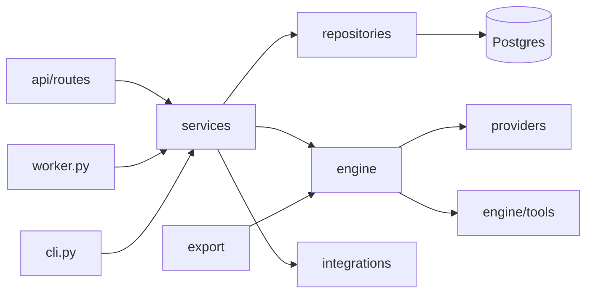

# Low-level design

How AgentStudio is built inside: the API's layers, the graph document, every node type,
the template language, validation, the execution engine, traces, model providers, tools,
the Python exporter and the HTTP surface. The [HLD](HLD.md) covers the system around it.
Paths are relative to `apps/api/src/agentstudio/` unless they start with a repository
folder.

## 1. Layout

```text
agentstudio/
  main.py  worker.py  cli.py     app factory, SQS worker, operator CLI
  core/          config, logging, errors, request context, security, crypto, rate limits, metrics, ids, text
  db/            engine and sessions, declarative base, migration runner
  models/        SQLAlchemy models, one module per aggregate
  schemas/       Pydantic request and response models
  repositories/  the only code that touches the database
  services/      business rules, transactions, cache invalidation, audit events
  api/           routes and dependencies (authentication, workspace roles, rate limits)
  engine/        graph models, validation, planning, expressions, the executor, node handlers, tools
  providers/     the model interface, the offline provider, OpenAI-compatible and Ollama adapters, pricing
  export/        the Python exporter
  integrations/  SQS or inline queue, S3 or local storage, Redis trace streams, the sandbox API
  templates/     the template gallery (one JSON graph per template)
  demo/          the `make demo` seed and its realistic inputs
```



| Layer | May import | Must not |
| --- | --- | --- |
| `api/routes` | schemas, services, `api/deps` | touch a session, a repository or Redis directly |
| `services` | repositories, `engine`, `export`, `providers`, `integrations`, `core` | import FastAPI |
| `repositories` | models, `db` | commit, call a service, or skip the `workspace_id` filter |
| `engine`, `providers`, `export` | `core` and each other | touch the database (the engine reaches storage only through the `RunRecorder` and `KnowledgeSearcher` ports a service hands it) |

**Workspace isolation.** Every repository method that reads workspace data takes
`workspace_id` as a required argument. The `WorkspaceAccess` dependency resolves the
caller's role before a route runs and answers `404` to non-members.

**Transactions.** A service method that writes opens and commits its own transaction.
Audit events are added to the same transaction as the change they record.

**Errors.** Services raise the typed errors in `core/errors.py`; one handler renders
`{"error": {"code", "message", "request_id", "details?"}}` and every response carries
`X-Request-Id`.

## 2. The graph document

A flow's draft, every version, every import and export is one JSON document:

```json
{
  "schema_version": 1,
  "nodes": [
    {
      "id": "classify",
      "type": "llm",
      "position": {"x": 320, "y": 80},
      "label": "Classify ticket",
      "config": {"model": "offline", "prompt": "Classify this ticket...", "output_mode": "json"},
      "settings": {"timeout_s": 60, "retries": 2, "retry_backoff_s": 1.0, "continue_on_error": false}
    }
  ],
  "edges": [
    {"id": "e_start_classify", "source": "start", "source_handle": "out", "target": "classify", "target_handle": "in"}
  ],
  "viewport": {"x": 0, "y": 0, "zoom": 1}
}
```

- **Node ids** are readable identifiers (`^[a-z][a-z0-9_]{0,39}$`), unique in the flow. They
  are what templates reference (`{{classify.json.priority}}`) and what the exported script
  names its variables after, so the editor generates them from the node type
  (`llm_2`) and lets builders rename them.
- **Handles.** Most nodes have one input handle `in` and one output handle `out`. The
  exceptions: Start has no input; Output has no output; Condition has one output per route
  (`route_<id>`) plus `else`; Human approval has `approved` and `rejected`; Loop has `body`
  (into its body subgraph) and `done` (after the last item); Agent has an extra input
  handle `tools`; tool nodes have an extra output handle `tool` used to attach them to an
  agent.
- **Settings** (timeouts, retries, continue on error, response caching) are common to every
  executable node; **config** is per type and validated by a Pydantic model per type
  (`engine/graph.py`, a discriminated union on `type`).

## 3. Node types

| Type | Label | Config | Output |
| --- | --- | --- | --- |
| `start` | Start | `inputs`: list of `{name, type (string, number, integer, boolean, object, array), description, required, default}`; `sample`: example inputs for the run dialog | the validated inputs |
| `llm` | Prompt | `model`, `system` (template), `prompt` (template), `temperature`, `max_tokens`, `output_mode` (`text` or `json`), `json_fields` (name, type, description, enum) for JSON mode | `{text}` or `{json, text}`, plus usage |
| `agent` | Agent | `model`, `system`, `task` (template), `max_iterations` (1 to 10), `temperature`, `output_mode`, `json_fields`; tools are the tool nodes attached to its `tools` handle | `{text, json?, tool_calls: [...], iterations}` |
| `http` | HTTP request | `method`, `url`, `headers`, `query`, `body_mode` (`none`, `json`, `text`), `body` (templates), `expect` (`json` or `text`), `fail_on_status`; as an agent tool also `tool_name`, `tool_description`, `parameters` | `{status, ok, json or text, headers}` |
| `knowledge` | Knowledge search | `knowledge_base_id`, `query` (template), `top_k`; tool fields as above | `{results: [{title, heading, snippet, text, score, document_id}], context}` |
| `calculator` | Calculator | `expression` (template that renders to arithmetic) | `{result}` |
| `json_transform` | JSON transform | `input` (template, usually a single reference), `expression` (JMESPath) | `{result}` |
| `condition` | Condition | `routes`: ordered `{id, label, match (all or any), rules: [{left, operator, right}]}`; the `else` route is implicit | `{route, label}` |
| `loop` | Loop | `items` (template resolving to a list), `max_items`, `concurrency` (1 to 8), `collect` (template evaluated per iteration), `continue_on_item_error` | `{results, count, failed}` |
| `approval` | Human approval | `title`, `message` (templates), `expires_after_hours` (optional) | `{decision, comment, decided_by, decided_at}` |
| `output` | Output | `fields`: `{name, value}` with template values | the fields; the run's outputs are the fields of every Output node that ran |
| `note` | Note | `text`, `color` | never executed |

Condition operators: `equals`, `not_equals`, `contains`, `not_contains`, `starts_with`,
`ends_with`, `greater_than`, `greater_or_equal`, `less_than`, `less_or_equal`, `is_empty`,
`is_not_empty`, `in_list`, `matches` (RE2 syntax, linear time).

## 4. The template language

Templates appear in prompts, URLs, headers, bodies, conditions and outputs:

| Syntax | Meaning |
| --- | --- |
| `{{inputs.subject}}` | a run input (also available as `{{start.subject}}`) |
| `{{classify.json.priority}}` | a field of an upstream node's output |
| `{{search.results[0].title}}` | list indexing |
| `{{item}}`, `{{index}}` | the current loop item and its position, inside a loop body (`{{loop_1.item}}` names an enclosing loop explicitly) |
| `{{secrets.CRM_TOKEN}}` | a workspace secret (masked in every trace) |
| `{{value \| json}}` | filters: `json`, `upper`, `lower`, `trim`, `length`, `first`, `last`, `join(", ")`, `default("n/a")` |

Rules that make templates predictable:

- A template that is exactly one `{{expression}}` returns the value itself (a list stays a
  list); anything else renders to a string, with non-strings rendered as JSON.
- A path that does not resolve renders as empty (or the `default` filter's value). Statically,
  the validator rejects references to nodes that do not exist or do not run before the
  node using them.
- There is no code execution: the language is paths and a fixed set of filters.

The implementation (`engine/expressions.py`) is pure and depends only on the standard
library and `jmespath`, because the Python exporter embeds it verbatim (section 9).

## 5. Validation

`engine/validate.py` takes a graph and a context (the knowledge bases, secrets and models
that exist) and returns a list of issues, each with `severity` (`error` or `warning`), a
stable `code`, a message, and the `node_id`, `edge_id` or `field` it is about. The editor
shows them inline; publishing is blocked by errors only.

| Code | Severity | Rule |
| --- | --- | --- |
| `missing_start`, `multiple_start` | error | exactly one Start node |
| `no_output` | warning | at least one Output node |
| `invalid_config` | error | the node's config fails its model (one issue per field) |
| `duplicate_id`, `invalid_id` | error | node ids are unique identifiers |
| `dangling_edge`, `invalid_handle` | error | edges join existing nodes on handles their types have |
| `duplicate_edge`, `self_loop` | error | |
| `cycle` | error | the data edges form a DAG (the nodes in each cycle are listed) |
| `missing_input` | error | every executable node except Start has an incoming edge |
| `unreachable` | error | every executable node can be reached from Start |
| `unknown_reference` | error | a template names a node that does not exist or does not run before it |
| `unused_route` | warning | a Condition route, approval branch or loop handle leads nowhere |
| `invalid_tool` | error | only HTTP, Knowledge, Calculator and JSON transform nodes attach to an agent; an attached tool is not also a step; tool names are unique per agent |
| `loop_escape` | error | an edge leaves or enters a loop body other than through the Loop node |
| `not_allowed_in_loop` | error | Start, Output and Human approval cannot sit inside a loop body |
| `unknown_knowledge_base`, `unknown_secret` | error | references resolve in this workspace |
| `model_unavailable` | warning | the model's provider is not configured on this deployment |
| `too_large` | error | node, edge and size limits |

## 6. The execution engine

### 6.1 Plan

`engine/plan.py` compiles a validated graph into a `Plan`: nodes by id; data edges in and out
of each node (attachment edges excluded); the tools attached to each agent; for each loop,
its body (the nodes reachable from its `body` handle) and the body's entry nodes; and a
deterministic topological order per scope (top level and each body). The exporter uses the
same plan, so script order equals engine order.

### 6.2 Scheduling a scope

```text
resolved = {}            # node id -> succeeded | failed_continued | skipped
fired = set()            # (source id, handle) pairs that fired
while some node in scope is unresolved:
    for node in scope, not started, every predecessor resolved:
        if node is the scope entry or any incoming edge is in fired: start it (bounded by the run semaphore)
        else: mark it skipped
    wait for the first running node to finish
    on success: record output, add (node, handle) to fired for each emitted handle
    on failure: retry per settings; then fail the run, or continue on error
    if nothing is running and nothing can start: the remaining nodes are waiting (approvals)
```

- Normal nodes emit `out`; a Condition emits the chosen `route_<id>` or `else`; an approval
  emits `approved` or `rejected`; a Loop emits `done`.
- A merge node waits for all its predecessors to resolve and runs if any branch reached it.
- Inside a loop body the Loop's `body` handle counts as fired for each iteration.

### 6.3 Steps, attempts, timeouts

Each node execution is one `run_steps` row keyed by `(run_id, node_id, iteration)`, where
`iteration` is empty at the top level, `"3"` for the fourth item of a loop and `"3/1"` for
a nested loop. Attempts reuse the row (`attempt` counts up; each retry is recorded in the
step's `events`). The node body runs under `asyncio.timeout(settings.timeout_s)`. Retryable
errors: timeouts, connection errors, HTTP 408, 425, 429 and 5xx from tools and providers.
Back-off is `retry_backoff_s * 2^(attempt - 1)`, plus up to 25 percent jitter.

### 6.4 Pause and resume

A run is resumable from Postgres alone. When a worker claims a run it loads the run's
existing steps: top-level steps that `succeeded`, were `skipped` or failed and continued are
restored with their outputs and fired handles without running again; an approval step whose
approval is decided becomes `succeeded` with the decision and fires its branch; everything
else runs. A Loop that did not finish runs all of its iterations again. This one mechanism
serves approvals, crash recovery and graceful shutdown.

### 6.5 Cancellation

`POST /runs/{id}/cancel` cancels queued and waiting runs directly. For a running run it sets
`cancel_requested_at` and the Redis key `run:{id}:cancel`; the executor checks the key every
half second, cancels its in-flight tasks, marks running steps `cancelled` and finishes the run
as `cancelled`.

### 6.6 Recording and masking

The executor talks to a `RunRecorder` port (`engine/recorder.py`). The service implementation
writes steps to Postgres and appends events to the run's Redis stream; tests use an in-memory
recorder. Before anything is recorded, every string is scanned for the values of the secrets
the run resolved and those are replaced with `[secret:NAME]`. Payloads above 256 KB are
truncated with a `_truncated` marker.

### 6.7 Trace events

| Event | Data |
| --- | --- |
| `run.started` | `run_id`, `status`, `started_at`, `resumed` |
| `step.started` | `node_id`, `node_type`, `label`, `iteration`, `attempt`, `input` |
| `step.progress` | `node_id`, `iteration`, one of: `tool_call` (name, arguments, result, latency), `retry` (attempt, error, delay), `model_call` (model, tokens, cached) |
| `step.finished` | `node_id`, `iteration`, `status`, `output`, `error`, `latency_ms`, `tokens`, `cost_usd`, `handles` |
| `step.waiting` | `node_id`, `approval_id` |
| `run.waiting` | `approval_ids` |
| `run.finished` | `status`, `outputs`, `error`, `duration_ms`, `prompt_tokens`, `completion_tokens`, `cost_usd` |

Stream ids double as SSE event ids, which is what makes `Last-Event-ID` reconnects exact.

## 7. Model providers

```python
class ChatProvider(Protocol):
    name: str
    async def complete(self, request: ChatRequest) -> ChatResponse: ...
    async def aclose(self) -> None: ...
```

`ChatRequest` carries OpenAI-style messages (system, user, assistant with tool calls, tool
results), the model name, temperature, max tokens, optional tools (name, description, JSON
schema) and an optional JSON output schema. `ChatResponse` returns text, tool calls, usage
and a finish reason. The registry (`providers/registry.py`) resolves a model reference
(`offline`, `openai:<model>`, `ollama:<model>`) to a provider and a price.

### 7.1 The offline provider

`providers/offline/` is a deterministic, rule-based stand-in for a model. Given the same
messages it always returns the same answer. It splits the prompt into instructions and
content (labelled blocks such as `Ticket:` or fenced text), detects the task and runs one of:

| Task | Detected by | Output |
| --- | --- | --- |
| Structured output | JSON mode with fields | one value per field: enum fields are classified, numbers, dates, emails, ids, names, money and line items are extracted by field-name rules, lists such as action items or questions are generated |
| Classification | "classify", "categorise", "label" plus a list of candidates | the best label by lexicon and term overlap |
| Summarisation | "summarise", "summary", "key points", "brief" | the top sentences in original order, as prose or bullets |
| Action items | "action items", "next steps", "to-do" | `Owner: task (due)` lines from commitments in the text |
| Drafting | "draft", "write", "reply", "respond", "email" | a templated reply: greeting by name, acknowledgement by topic and sentiment, the most relevant context sentences, a next step, the requested sign-off |
| Answering from context | a question plus a context block | the most relevant context sentences, with source titles |
| Tool use | tools offered and no result for them yet | calls to every tool whose name and description match the task and whose required arguments can be filled from the text (an email domain, an arithmetic expression, a query); after the results arrive, a final answer that uses them |

Token counts use a fixed word-piece heuristic. Costs use a configurable simulated price
and are labelled as simulated. An optional delay proportional to output length makes live
traces visible in demos (`OFFLINE_DELAY_MS_PER_100_TOKENS`, zero in tests).

The same provider is served over HTTP as an OpenAI-compatible endpoint
(`POST /api/v1/offline/v1/chat/completions`), which is what exported scripts call by default.

### 7.2 Response cache

Nodes with `settings.cache_ttl_s > 0` and temperature 0 cache model responses in Redis under
a hash of the provider, model, messages, tools and output schema. A hit is recorded on the
step (`cached: true`) and costs nothing.

## 8. Tools

| Tool | Implementation |
| --- | --- |
| HTTP request | `engine/tools/http.py`: one `httpx.AsyncClient` per worker with a guarded network backend that resolves every host and refuses loopback, private, link-local, CGNAT, multicast and metadata addresses at connect time (so redirects and DNS rebinding are covered too), unless the host is in `HTTP_ALLOWED_HOSTS` or `HTTP_ALLOW_PRIVATE_NETWORKS=true`. Responses are capped at `HTTP_MAX_RESPONSE_KB`. Requests to `sandbox.agentstudio.test` are routed in process to the sandbox app. |
| Sandbox API | `integrations/sandbox/`: fixture endpoints with deterministic data (`/crm/companies/{domain}`, `/crm/contacts`, `/erp/vendors`, `/tasks`, `/fx/rates`), served in process to the engine and publicly under `/sandbox` for exported scripts. |
| Knowledge search | `services/knowledge.py` through the `KnowledgeSearcher` port: `websearch_to_tsquery` over the chunk `tsvector` with `ts_rank_cd`, falling back to an OR query of the content terms when nothing matches all terms; `ts_headline` snippets. |
| Calculator | `engine/expressions.py`: an AST evaluator for numbers, `+ - * / // % **`, parentheses and `round`, `min`, `max`, `abs`, `sqrt`, `floor`, `ceil`; exponent and magnitude limits. |
| JSON transform | JMESPath over the rendered input. |

## 9. The Python exporter

`export/python.py` turns a graph into a script:

1. A docstring: the flow name and version, how to install (`pip install httpx jmespath`), the
   environment variables (`LLM_BASE_URL`, `LLM_API_KEY`, `AGENTSTUDIO_URL`,
   `AGENTSTUDIO_API_KEY`, `SECRET_<NAME>`, `APPROVAL_MODE`) and an example command.
2. Constants: the input schema, the model map and every template, as Python literals
   produced by `repr()` (user text never becomes code).
3. The runtime: `engine/expressions.py` embedded verbatim, followed by an OpenAI-compatible
   chat client, the agent loop and the tool helpers.
4. `async def run_flow(inputs, client)`: one block per node in plan order. Each block checks
   whether one of its incoming edges fired, runs the node, stores `out["<node id>"]` and
   fires its handles; loop bodies become nested functions.
5. A `main()` that parses `--input` (JSON) or `--input-file`, runs the flow and prints the
   outputs as JSON.

The integration test exports every template, runs `compile()` on it, executes it against the
offline endpoint and compares its outputs with the engine's run of the same inputs.

## 10. HTTP surface

All under `/api/v1`; `{ws}` is a workspace id or slug. Roles: V viewer, E editor, O owner.

| Area | Endpoints |
| --- | --- |
| Auth | `POST /auth/login`, `POST /auth/signup`, `POST /auth/logout`, `GET /auth/me`, `PATCH /auth/me`, `POST /auth/password` |
| Workspaces | `GET /workspaces`, `POST /workspaces`, `GET (V) PATCH (O) DELETE (O) /workspaces/{ws}`, `GET (V) POST (O) /workspaces/{ws}/members`, `PATCH (O) DELETE /workspaces/{ws}/members/{user_id}`, `GET /workspaces/{ws}/audit` (O) |
| API keys | `GET POST /workspaces/{ws}/api-keys`, `DELETE /workspaces/{ws}/api-keys/{id}` (O) |
| Dashboard | `GET /workspaces/{ws}/dashboard` (V) |
| Flows | `GET (V) POST (E) /workspaces/{ws}/flows`, `POST /flows/import` (E), `GET (V) PATCH (E) DELETE (E) /flows/{flow}`, `PUT /flows/{flow}/draft` (E), `POST /flows/{flow}/validate` (V), `POST /flows/{flow}/duplicate` (E) |
| Versions | `POST /flows/{flow}/publish` (E), `GET /flows/{flow}/versions` (V), `GET /flows/{flow}/versions/{n}` (V), `POST /flows/{flow}/versions/{n}/restore` (E) |
| Export | `GET /flows/{flow}/export` (JSON), `GET /flows/{flow}/export/python` (V) |
| Webhook | `GET (E) PUT (E) DELETE (E) /flows/{flow}/webhook` (enable or rotate returns the secret once) |
| Runs | `POST /flows/{flow}/runs` (E; `?wait=` up to 30 s), `GET /workspaces/{ws}/runs` (V, filters), `GET /runs/{id}` (V), `GET /runs/{id}/events` (V, SSE), `POST /runs/{id}/cancel` (E), `POST /runs/{id}/rerun` (E) |
| Approvals | `GET /workspaces/{ws}/approvals` (V), `GET /approvals/{id}` (V), `POST /approvals/{id}/decision` (E) |
| Knowledge | `GET (V) POST (E) /workspaces/{ws}/knowledge-bases`, `GET PATCH DELETE /knowledge-bases/{kb}`, `GET (V) POST (E, multipart) /knowledge-bases/{kb}/documents`, `GET DELETE /documents/{doc}`, `POST /knowledge-bases/{kb}/search` (V) |
| Secrets | `GET (E) POST (O) /workspaces/{ws}/secrets`, `PUT (O) DELETE (O) /secrets/{name}` (values are write-only) |
| Templates | `GET /templates`, `GET /templates/{slug}` |
| Models | `GET /models` (the configured providers and models, with the offline flag) |
| Offline provider | `POST /offline/v1/chat/completions`, `GET /offline/v1/models` (any authenticated principal) |
| Webhooks in | `POST /hooks/{hook_id}` (signed, no session) |
| System | `GET /system/info`; `/livez`, `/readyz`, `/metrics` at the root |

Flow, run, approval and knowledge routes nest under `/workspaces/{ws}/`; the table shortens
them. Every list takes `limit` (1 to 100) and `offset` and returns `{items, total, limit, offset}`.

Authentication: the `agentstudio_session` cookie (httpOnly, `SameSite=Lax`) for the web
app, or `Authorization: Bearer` with a session token or a workspace API key
(`agst_<prefix>_<secret>`). Cookie requests with unsafe methods must carry an `Origin` (or
`Referer`) of the web app.

Rate limits (fixed windows in Redis, per principal): sign-in 10 per minute per IP, run
starts 60 per minute, webhook deliveries 120 per minute per hook, offline completions 600
per minute, knowledge uploads 60 per minute.

## 11. Configuration

`core/config.py` declares every setting with its type and default (pydantic-settings, one
frozen instance per process). `production_problems()` lists every unsafe value at once and
the app refuses to boot with any of them when `APP_ENV=production`: development secrets,
`COOKIE_SECURE=false`, wildcard CORS, the inline queue, local storage, an emulator endpoint,
private-network HTTP enabled. The full reference is
[docs/guides/configuration.md](../guides/configuration.md).

## 12. Worker

`worker.py` long-polls SQS (`WaitTimeSeconds=10`) for up to `WORKER_CONCURRENCY` runs at a
time, extends message visibility while a run executes, deletes the message when the run
finishes or pauses, and stops receiving on SIGTERM, letting in-flight runs finish within
`WORKER_SHUTDOWN_GRACE_S`. Every 30 seconds one worker (elected with a Redis lock) re-queues
runs whose heartbeat is older than 90 seconds and expires approvals past their deadline.

## 13. Testing strategy

| Suite | Scope |
| --- | --- |
| Unit (`apps/api/tests/unit`) | Pure modules: graph models, validation rules, templating, conditions, calculator, JSON transforms, planning, the executor with an in-memory recorder and fake providers (parallelism, skips, merges, loops, retries, timeouts, cancellation, pause and resume), the offline provider tasks, the provider adapters against mocked HTTP, the SSRF guard, crypto, signatures, the exporter (including hostile strings), the HTTP layer |
| Integration (`apps/api/tests/integration`) | The app in process against real Postgres, Redis and Floci (SQS, S3) started by `scripts/test-deps.sh`: every route, workspace isolation sweeps, runs end to end through SQS and the worker loop, SSE replay, approvals pause and resume, webhooks, knowledge search, every template run and its exported script |
| Web unit (`apps/web`, Vitest) | Graph adapters, undo and redo history, auto-layout, inspector form logic, SSE event reducer |
| End to end (`e2e/`, Playwright) | Sign-in, building and running a flow on the canvas, live traces, approvals, templates, exports, run history |
