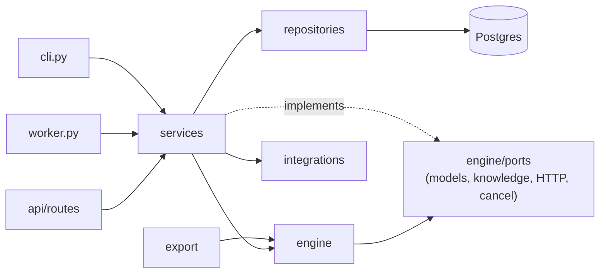

# Low-level design

How AgentStudio is built inside: the API's layers, the graph document, every node type,
the template language, validation, the execution engine, traces, model providers, tools,
the Python exporter, the HTTP surface and the web app. The [HLD](HLD.md) covers the system
around it. Paths are relative to `apps/api/src/agentstudio/` unless they start with a
repository folder.

## 1. Layout

```text
agentstudio/
  main.py  worker.py  cli.py   app factory, SQS run worker, operator CLI
  core/          config, logging, errors, request context, security, crypto, rate limits, metrics, ids, text
  db/            engine and sessions, declarative base, migration runner, migrations/
  models/        SQLAlchemy models, one module per aggregate
  schemas/       Pydantic request and response models
  repositories/  the only code that touches the database
  services/      business rules, transactions, cache invalidation, audit events
  api/           routes, presenters and dependencies (authentication, workspace roles, rate limits)
  engine/        graph models, validation, planning, the shared runtime, node handlers, the executor
  providers/     the model interface, the offline provider, OpenAI-compatible and Ollama adapters, pricing
  export/        the Python exporter
  integrations/  SQS or inline queue, S3 or local storage, Redis trace streams, the guarded HTTP client, the sandbox API
  ingestion/     document chunking for knowledge bases
  templates/     the template gallery (catalog.py) and the knowledge documents templates install
  demo/          the `make demo` seed and its realistic inputs
```



| Layer | May import | Must not |
| --- | --- | --- |
| `api/routes` | schemas, services, presenters, `api/deps` | touch a repository, Redis or SQL directly |
| `services` | repositories, `engine`, `export`, `providers`, `integrations`, `core` | import FastAPI |
| `repositories` | models, `db` | commit, call a service, or skip the `workspace_id` filter |
| `engine`, `export` | `core` and each other | touch the database: the engine reaches models, knowledge, HTTP and the cancel flag only through the ports in `engine/ports.py`, and records through `engine/recorder.py` |

**Workspace isolation.** Every repository method that reads workspace data takes
`workspace_id` as a required argument. The workspace dependencies in `api/deps.py` resolve
the caller's role before a route runs and answer `404` to non-members, so a workspace's
existence never leaks.

**Transactions.** A service method that writes commits its own transaction. Audit events
are added to the same transaction as the change they record.

**Errors.** Services raise the typed errors in `core/errors.py`; one handler renders
`{"error": {"code", "message", "request_id", "details?"}}` and every response carries
`X-Request-Id`.

## 2. The graph document

A flow's draft, every version, every import and export is one JSON document
(`engine/graph.py`, `GraphDocument`):

```json
{
  "schema_version": 1,
  "nodes": [
    {
      "id": "classify",
      "type": "llm",
      "position": {"x": 320, "y": 80},
      "label": "Classify ticket",
      "config": {"model": "offline", "prompt": "Classify this ticket...", "output_mode": "json"},
      "settings": {"timeout_s": 60, "retries": 2, "retry_backoff_s": 1.0, "continue_on_error": false}
    }
  ],
  "edges": [
    {"id": "e_start_out_classify_in", "source": "start", "source_handle": "out", "target": "classify", "target_handle": "in"}
  ],
  "viewport": {"x": 0, "y": 0, "zoom": 1}
}
```

- **The document is lenient, validation is strict.** `config` and `settings` are plain
  objects in the document, so a node dropped on the canvas a second ago (an empty prompt)
  still saves. The per-type Pydantic models are applied by validation, which reports
  problems as issues, and by the engine, which only ever runs a valid graph.
- **Node ids** are readable identifiers (`^[a-z][a-z0-9_]{0,39}$`), unique in the flow, and
  not one of the template language's own names (`inputs`, `secrets`, `item`, `index`,
  `args`, `run`, `loop`). They are what templates reference (`{{classify.json.priority}}`)
  and what the exported script names its blocks after. The editor generates them from the
  node type (`prompt`, `prompt_2`, `http_request`).
- **Handles.** Most nodes have one input handle `in` and one output handle `out`. The
  exceptions: Start has no input; Output has no output; Condition has one output per route
  (`route_<id>`) plus `else`; Human approval has `approved` and `rejected`; Loop has `body`
  (into its body subgraph) and `done` (after the last item); Agent has an extra input
  handle `tools`; the four tool nodes have an extra output handle `tool` that lends them to
  an agent.
- **Settings** (timeout, retries, back-off, continue on error, response caching) are common
  to every executable node; **config** is per type (section 3).

## 3. Node types

| Type | Label | Config | Output |
| --- | --- | --- | --- |
| `start` | Start | `inputs`: `{name, type (string, number, integer, boolean, object, array), description, required, default}`; `sample`: example inputs that prefill the run dialog | the validated inputs |
| `llm` | Prompt | `model`, `system`, `prompt` (templates), `temperature`, `max_tokens`, `output_mode` (`text` or `json`), `json_fields` (name, type, description, enum, items) | `{text}` or `{json, text}` |
| `agent` | Agent | `model`, `system`, `task` (templates), `max_iterations` (capped by `MAX_AGENT_ITERATIONS`), `temperature`, `max_tokens`, `output_mode`, `json_fields`; its tools are the tool nodes wired to its `tools` handle | `{text, json?, tool_calls: [{name, arguments, result}], iterations}` |
| `http` | HTTP request | `method`, `url`, `headers`, `query` (key and template value), `body_mode` (`none`, `json`, `text`), `body`, `expect` (`json` or `text`), `fail_on_status`; as a tool also `tool_name`, `tool_description` and `parameters` the agent fills in (`{{args.name}}`) | `{status, ok, json or text, content_type}` |
| `knowledge` | Knowledge search | `knowledge_base_id`, `query` (template; empty when lent to an agent), `top_k`; tool fields | `{results: [{chunk_id, document_id, title, heading, text, snippet, score}], context}` |
| `calculator` | Calculator | `expression` (a template that renders to arithmetic); tool fields | `{result}` |
| `json_transform` | JSON transform | `input` (template, usually one reference), `expression` (JMESPath); tool fields | `{result}` |
| `condition` | Condition | `routes`: ordered `{id, label, match (all or any), rules: [{left, operator, right}]}`; the `else` route is implicit | `{route, label}` |
| `loop` | Loop | `items` (a template resolving to a list), `max_items`, `concurrency` (1 to 8), `collect` (template evaluated per item), `continue_on_item_error` | `{results, count, failed}` |
| `approval` | Human approval | `title`, `message` (templates), `expires_after_hours` (optional) | `{decision, comment, decided_by, decided_at}` |
| `output` | Output | `fields`: `{name, value}` with template values | the fields; the run's outputs are the fields of every Output node that ran |
| `note` | Note | `text`, `color` | never executed |

Condition operators: `equals`, `not_equals`, `contains`, `not_contains`, `starts_with`,
`ends_with`, `greater_than`, `greater_or_equal`, `less_than`, `less_or_equal`, `is_empty`,
`is_not_empty`, `in_list`, `matches` (RE2 syntax through `google-re2`, linear time, so a
pattern cannot hang a worker).

## 4. The template language

Templates appear in prompts, URLs, headers, bodies, conditions, loop items and outputs:

| Syntax | Meaning |
| --- | --- |
| `{{inputs.subject}}` | a run input |
| `{{classify.json.priority}}` | a field of an upstream node's output |
| `{{search.results[0].title}}` | list indexing |
| `{{item}}`, `{{index}}` | the current loop item and its position, inside a loop body (`{{each_question.item}}` names an enclosing loop) |
| `{{args.email}}` | an argument the agent passed, inside a tool lent to an agent |
| `{{secrets.CRM_TOKEN}}` | a workspace secret (masked in every trace) |
| `{{value \| json}}` | filters: `json`, `upper`, `lower`, `trim`, `length`, `first`, `last`, `join(", ")`, `default("n/a")`, `round(2)` |

Rules that make templates predictable:

- A template that is exactly one `{{expression}}` returns the value itself (a list stays a
  list); anything else renders to a string, with non-strings rendered as JSON.
- A path that does not resolve renders as empty (or as the `default` filter's value).
  Statically, the validator rejects references to nodes that do not exist or do not run
  before the node using them.
- There is no code execution: the language is paths and a fixed set of filters.

The implementation is `engine/runtime.py`: templating, conditions, the calculator, JSON
transforms, message building and tool plumbing. It depends only on the standard library,
`jmespath` and (optionally) `re2`, because the Python exporter embeds it verbatim
(section 9) and the exported script then behaves exactly like the engine.

## 5. Validation

`engine/validate.py` takes a graph and a context (the knowledge bases, secrets and models
that exist in the workspace) and returns issues, each with `severity` (`error` or
`warning`), a stable `code`, a message, and the `node_id`, `edge_id` or `field` it is
about. Every draft save returns them; the editor shows them inline, and publishing is
blocked by errors only.

| Code | Severity | Rule |
| --- | --- | --- |
| `missing_start`, `multiple_start` | error | exactly one Start node |
| `no_output` | warning | at least one Output node |
| `invalid_config` | error | the node's config fails its model (one issue per field, with the field path) |
| `invalid_template` | error | a template does not parse |
| `duplicate_id`, `invalid_id` | error | node ids are unique identifiers and not reserved names |
| `dangling_edge`, `invalid_handle` | error | edges join existing nodes on handles their types have |
| `duplicate_edge`, `self_loop` | error | |
| `cycle` | error | the flow edges form a DAG |
| `missing_input` | error | every executable node except Start has an incoming edge |
| `unreachable` | error | every executable node can be reached from Start |
| `unknown_reference` | error | a template names a node that does not exist or does not run before it |
| `unused_route` | warning | a Condition route, an approval branch or a loop body leads nowhere |
| `invalid_tool` | error | only HTTP, Knowledge, Calculator and JSON transform nodes lend themselves to an agent; tool names are unique per agent |
| `loop_escape` | error | an edge enters or leaves a loop body other than through the Loop node |
| `not_allowed_in_loop` | error | Start, Output and Human approval cannot sit inside a loop body |
| `unknown_knowledge_base`, `unknown_secret` | error | references resolve in this workspace |
| `model_unavailable` | warning | the model's provider is not configured on this deployment |
| `too_large` | error | node, edge and document size limits |

## 6. The execution engine

### 6.1 Plan

`engine/plan.py` compiles a valid graph into a `Plan`: nodes by id with their parsed
configs and settings; flow edges in and out of each node (tool edges excluded); the tools
lent to each agent; for each loop, its body (the nodes reachable from its `body` handle);
and a deterministic topological order per scope (top level and each loop body). The
exporter uses the same plan, so the script's order is the engine's order.

### 6.2 Scheduling a scope

```text
resolved = {}            # node id -> succeeded | continued | skipped
fired = set()            # (source id, handle) pairs that fired
while some node in scope is unresolved:
    for node in scope, not started, every predecessor resolved:
        if node is the scope entry or any incoming edge fired: start it (bounded by MAX_PARALLEL_STEPS)
        else: mark it skipped
    wait for the first running node to finish
    on success: record its output, add (node, handle) to fired for each handle it emitted
    on failure: retry per its settings; then fail the run, or continue on error
    if nothing is running and nothing can start: the run is waiting (an approval)
```

- Normal nodes emit `out`; a Condition emits the chosen `route_<id>` or `else`; an approval
  emits `approved` or `rejected`; a Loop emits `done` after its last item.
- A merge node waits for all its predecessors to resolve and runs if any branch reached it.
- Inside a loop body the Loop's `body` handle counts as fired for each item.

### 6.3 Steps, attempts, timeouts

Each node execution is one `run_steps` row keyed by `(run_id, node_id, iteration)`, where
`iteration` is empty at the top level, `"3"` for the fourth item of a loop and `"3/1"` for
a nested loop. Attempts reuse the row (`attempt` counts up). The node runs under
`asyncio.timeout(settings.timeout_s)`. Retryable errors: timeouts, connection errors and
HTTP 408, 425, 429 and 5xx from tools and providers. Back-off is
`retry_backoff_s * 2^(attempt - 1)`, plus up to 25 percent jitter.

### 6.4 Pause and resume

A run is resumable from Postgres alone. When a worker claims a run it loads the run's
existing steps and approvals into a `ResumeState`: steps that succeeded, were skipped or
failed and continued are restored with their outputs and fired handles without running
again; an approval step whose approval is decided becomes `succeeded` with the decision and
fires its branch; everything else runs. This one mechanism serves approvals, crash recovery
and graceful shutdown.

### 6.5 Cancellation

`POST /runs/{id}/cancel` cancels queued and waiting runs directly (a waiting run's open
approval is cancelled with it). For a running run it sets the Redis flag the executor
polls every half second; the executor cancels its in-flight tasks, marks running steps
`cancelled` and finishes the run as `cancelled`.

### 6.6 Recording and masking

The executor talks to a recorder (`engine/recorder.py`). `services/runs.py` implements it
by writing steps to Postgres and appending events to the run's Redis stream; tests use the
in-memory recorder. Before anything is recorded, every string is scanned for the values of
the secrets the run resolved, which become `[secret:NAME]`. Payloads above
`MAX_STEP_PAYLOAD_KB` (256 by default) are truncated with a marker.

### 6.7 Trace events

| Event | Data |
| --- | --- |
| `run.queued` | `run_id`, `status`, `version`, `trigger` |
| `run.started` | `status`, `resumed` |
| `step.started` | `node_id`, `node_type`, `label`, `iteration`, `seq`, `attempt`, `input` |
| `step.progress` | `node_id`, `iteration`, `event` (an agent's `tool_call`: name, arguments, result, latency) |
| `step.finished` | `node_id`, `node_type`, `iteration`, `status`, `attempt`, `output`, `error`, `handles`, `model`, `prompt_tokens`, `completion_tokens`, `cost_usd`, `cached`, `continued`, `latency_ms` |
| `step.waiting` | `node_id`, `approval_id`, `title` |
| `approval.decided` | `approval_id`, `node_id`, `status`, `decided_by`, `comment` |
| `run.waiting` | `status`, `waiting_on` |
| `run.finished` | `status`, `outputs`, `error`, `prompt_tokens`, `completion_tokens`, `cost_usd`, `duration_ms` |

Stream ids double as SSE event ids, which is what makes `Last-Event-ID` reconnects exact,
and they carry the millisecond each event was written, which the web app uses to place
live steps on the timeline.

## 7. Model providers

```python
class ChatProvider(Protocol):
    name: str
    async def complete(self, request: ChatRequest) -> ChatResponse: ...
    async def aclose(self) -> None: ...
```

`ChatRequest` carries OpenAI-style messages (system, user, assistant with tool calls, tool
results), the model, temperature, max tokens, optional tools (name, description, JSON
schema) and an optional response format. `ChatResponse` returns text, tool calls, usage
and a finish reason. The registry (`providers/registry.py`) resolves a model reference
(`offline`, `openai:<model>`, `ollama:<model>`) to a provider and a price, and owns the
response cache.

### 7.1 The offline provider

`providers/offline/` is a deterministic, rule-based stand-in for a model: given the same
messages it always returns the same answer. It splits the prompt into instructions and
content (labelled blocks such as `Ticket:`), detects the task and runs one of:

| Task | Detected by | Output |
| --- | --- | --- |
| Structured output | JSON mode with fields | one value per field: enum fields are classified, numbers, dates, emails, ids, names, money and line items are extracted by field-name rules, lists such as action items or questions are generated |
| Classification | "classify", "categorise", "label" with a list of candidates ("one of: a, b", "as a, b or c") | the best label by lexicon and term overlap |
| Summaries and briefs | "summarise", "summary", "key points", "brief" | the top sentences in original order, as prose or bullets; briefs with cited findings |
| Action items | "action items", "next steps", "to-do" | `Owner: task (due)` lines from commitments in the text |
| Drafting | "draft", "write", "reply", "email" | a templated reply: greeting by name, acknowledgement by topic, the most relevant context sentences, a next step, the requested sign-off |
| Answering from context | a question plus a context block | the most relevant sentences, with their source numbers |
| Tool use | tools offered and no result for them yet | calls to every tool whose name and description fit the task and whose arguments can be filled from the text (a domain, an arithmetic or percentage expression, a query); after the results arrive, a final answer that uses them |

Token counts use a fixed word-piece heuristic. Costs use a configurable price and are
labelled as simulated. An optional delay proportional to output length
(`OFFLINE_DELAY_MS_PER_100_TOKENS`) gives live traces a realistic pace; the answers do not
change.

The same provider is served over HTTP as an OpenAI-compatible endpoint
(`POST /api/v1/offline/v1/chat/completions`), which exported scripts call by default.

### 7.2 Response cache

Model nodes with `settings.cache_ttl_s > 0` and temperature 0 cache responses in Redis
under a hash of the workspace, provider, model, messages, tools and response format. The
workspace is part of the key (runs reach the registry through `WorkspaceModels`), so one
tenant's cache never answers, or confirms, another tenant's identical prompt. A hit is
recorded on the step (`cached: true`) and costs nothing.

## 8. Tools

| Tool | Implementation |
| --- | --- |
| HTTP request | `integrations/http.py`: one `httpx.AsyncClient` with a guarded network backend that resolves every host and refuses loopback, private, link-local, CGNAT, multicast and metadata addresses at connect time (so redirects and DNS rebinding are covered too), unless the host is in `HTTP_ALLOWED_HOSTS` or `HTTP_ALLOW_PRIVATE_NETWORKS=true`. Responses are capped at `HTTP_MAX_RESPONSE_KB`. Requests to `sandbox.agentstudio.test` are routed in process to the sandbox app. |
| Sandbox API | `integrations/sandbox/`: fixture endpoints with deterministic data (`/crm/contacts`, `/crm/companies/lookup`, `/erp/vendors`, `/tasks`, `/fx/rates`), served in process to the engine and publicly under `/sandbox` for exported scripts. |
| Knowledge search | `services/knowledge.py` through the `KnowledgeSearcher` port: `websearch_to_tsquery` over the chunks' `tsvector` with `ts_rank_cd`, falling back to an OR query of the content terms when nothing matches every term; `ts_headline` snippets with the matched terms marked. |
| Calculator | `engine/runtime.py`: an AST evaluator for numbers, `+ - * / // % **`, parentheses, `pi`, `e` and `round`, `min`, `max`, `abs`, `sqrt`, `floor`, `ceil`, with exponent and magnitude limits. |
| JSON transform | JMESPath over the rendered input. |

## 9. The Python exporter

`export/python.py` turns a plan into one readable script:

1. A docstring: the flow name and version, how to install (`pip install httpx jmespath`) and
   run it, and the environment variables (`AGENTSTUDIO_URL`, `AGENTSTUDIO_API_KEY`,
   `LLM_BASE_URL`, `LLM_API_KEY`, `LLM_MODEL`, `SECRET_<NAME>`, `APPROVAL_MODE`).
2. Constants: the input schema, the models and every node's configuration, as Python
   literals produced by `repr()` (user text never becomes code).
3. The runtime: `engine/runtime.py` embedded verbatim, followed by an OpenAI-compatible
   chat client, the agent loop and the tool helpers.
4. `async def run_flow(inputs, client)`: one commented block per node in plan order. Each
   block checks whether one of its incoming edges fired, runs the node and fires its
   handles; loop bodies become nested functions.
5. A `main()` that reads `--input` (JSON) or `--input-file`, decides approvals by
   `--approve`, `--reject` or a prompt on a terminal, runs the flow and prints the outputs.

The unit suite compiles every template's script, runs it against the offline model and
asserts its outputs equal the engine's, including hostile strings that try to break out of
literals; the integration suite downloads scripts from the API and runs them as separate
processes against a live server.

## 10. HTTP surface

All under `/api/v1`; workspace routes take a workspace id or slug. Roles: V viewer, E
editor, O owner.

| Area | Endpoints |
| --- | --- |
| Auth | `POST /auth/login`, `POST /auth/signup` (first account, or when `ALLOW_SIGNUP`), `POST /auth/logout`, `GET PATCH /auth/me`, `POST /auth/password` |
| Workspaces | `GET POST /workspaces`, `GET (V) PATCH (O) DELETE (O) /workspaces/{ws}`, `GET (V) POST (O) /workspaces/{ws}/members`, `PATCH (O) DELETE /workspaces/{ws}/members/{user}`, `GET /workspaces/{ws}/audit` (O) |
| API keys | `GET POST /api-keys`, `DELETE /api-keys/{id}` (O) |
| Dashboard | `GET /dashboard` (V) |
| Flows | `GET (V) POST (E) /flows`, `GET /flows/tags` (V), `POST /flows/import` (E), `GET (V) PATCH (E) DELETE (E) /flows/{flow}`, `PUT /flows/{flow}/draft` (E), `POST /flows/{flow}/validate` (V), `POST /flows/{flow}/duplicate` (E) |
| Versions | `POST /flows/{flow}/publish` (E), `GET /flows/{flow}/versions` (V), `GET /flows/{flow}/versions/{n}` (V), `POST /flows/{flow}/versions/{n}/restore` (E) |
| Export | `GET /flows/{flow}/export` (JSON, V), `GET /flows/{flow}/export/python` (V) |
| Webhook | `GET PUT DELETE /flows/{flow}/webhook` (E; enabling or rotating returns the secret once) |
| Runs | `POST /flows/{flow}/runs` (E; `?wait=` seconds, capped by `MAX_RUN_WAIT_S`), `GET /runs` (V; flow, status and trigger filters), `GET /runs/{id}` (V), `GET /runs/{id}/events` (V, SSE), `POST /runs/{id}/cancel` (E), `POST /runs/{id}/rerun` (E) |
| Approvals | `GET /approvals` (V; status filter), `GET /approvals/{id}` (V), `POST /approvals/{id}/decision` (E) |
| Knowledge | `GET (V) POST (E) /knowledge-bases`, `GET PATCH DELETE /knowledge-bases/{kb}`, `GET (V) POST (E, multipart) /knowledge-bases/{kb}/documents`, `GET DELETE /knowledge-bases/{kb}/documents/{doc}`, `GET .../documents/{doc}/content`, `POST /knowledge-bases/{kb}/search` (V) |
| Secrets | `GET (E) POST (O) /secrets`, `PATCH (O) DELETE (O) /secrets/{name}` (values are write-only) |
| Catalog | `GET /templates`, `GET /templates/{slug}`, `GET /models` |
| Offline model | `POST /offline/v1/chat/completions`, `GET /offline/v1/models` (any signed-in person or API key) |
| Webhooks in | `POST /hooks/{hook_id}` (signed, no session) |
| System | `GET /system/info`; `/livez`, `/readyz`, `/metrics` at the root |

Flow, run, approval, knowledge, secret, key and dashboard routes nest under
`/workspaces/{ws}/`; the table shortens them. Every list takes `limit` (1 to 100) and
`offset` and returns `{items, total, limit, offset}`.

Authentication: the `agentstudio_session` cookie (httpOnly, `SameSite=Lax`) for the web
app, or `Authorization: Bearer` with a session token or a workspace API key
(`agst_<prefix>_<secret>`). Cookie requests with unsafe methods must carry an `Origin` (or
`Referer`) of the web app.

Rate limits (fixed windows in Redis): sign-in 10 per minute per client IP (and an account
locks for a while after repeated wrong passwords), run starts 60 per minute per principal, webhook deliveries 120 per minute per hook, offline completions 600
per minute, knowledge uploads 60 per minute.

## 11. Configuration

`core/config.py` declares every setting with its type and default (pydantic-settings).
`production_problems()` lists every unsafe value at once, and the API and the worker refuse
to start with any of them when `APP_ENV=production`: development secrets, equal session and
API key secrets, `COOKIE_SECURE=false`, wildcard CORS, the inline queue, local storage, an
emulator endpoint, private-network HTTP. The full reference is
[docs/guides/configuration.md](../guides/configuration.md).

## 12. Worker

`worker.py` long-polls SQS for up to `WORKER_CONCURRENCY` runs at a time with a 300-second
visibility timeout, extends visibility every 150 seconds while a run executes, deletes the
message when the run finishes or pauses, and on SIGTERM stops receiving and gives in-flight
runs `WORKER_SHUTDOWN_GRACE_S` to finish before handing the rest back (status queued,
message visible at once). Every 30 seconds one worker (elected with a Redis lock)
re-queues runs whose heartbeat is older than `STALE_RUN_S`, fails runs that lost their
worker five times, sends again any run still `queued` five minutes after it was last put on
the queue (its message was lost, or the queue was unreachable when it started: the run row
is the outbox, so a stored run is never failed for a send error), and expires approvals
past their deadline. With `QUEUE_BACKEND=inline` the API does all of this itself.

## 13. The web app

`apps/web` is a Next.js App Router application, rendered on the client against the API.

| Area | Files |
| --- | --- |
| Runtime configuration | `src/app/env.js/route.ts` serves `window.__AGENTSTUDIO__` (the API URL, the product name) at request time |
| Data | `src/lib/api.ts` (fetch with the session cookie, the error envelope), `src/lib/queries.ts` (TanStack Query hooks for every resource) |
| The canvas | `src/components/editor/`: `editor.tsx` (React Flow, autosave with revision checks, undo and redo, tidy-up with dagre, live runs), `canvas-node.tsx` (typed handles, status rings), `palette.tsx` (drag or click to add), `inspector.tsx` and `forms.tsx` (a form per node type), `fields.tsx` (the reference picker), `dialogs.tsx` (run, publish, versions, export, triggers) |
| Pure logic | `src/lib/nodes.ts` (the node catalog and handles), `graph.ts` (conversion, connection rules, layout), `history.ts` (undo), `variables.ts` (what a node can reference), `trace.ts` (the SSE reducer), `runs.ts` (timelines) |
| Live traces | `src/lib/use-run-stream.ts`: an `EventSource` per run; reconnects resume from `Last-Event-ID`, and the reducer is idempotent, so a replay never double counts |

## 14. Testing strategy

| Suite | Scope |
| --- | --- |
| API unit (`apps/api/tests/unit`) | Pure modules: graph models, validation rules, templating, conditions, the calculator, JSON transforms, planning, the executor with an in-memory recorder (parallelism, skips, merges, loops, retries, timeouts, cancellation, pause and resume), the offline provider, the provider adapters against mocked HTTP, the SSRF guard, the sandbox, templates, the exporter (including hostile strings and scripts run as programs) |
| API integration (`apps/api/tests/integration`) | The app against real Postgres, Valkey and Floci (S3, SQS) from `scripts/test-deps.sh`: auth, workspaces, keys, flows, runs and live traces, approvals and expiry, knowledge on S3, secrets, webhooks, the SQS worker (duplicates, lost workers, graceful handover), every template and its exported script against a live server, the dashboard, a cross-workspace isolation sweep |
| Web unit (`apps/web`, Vitest) | The node catalog, graph conversion and connection rules, layout, undo history, references, the trace reducer, timelines, formatting |
| End to end (`e2e/`, Playwright) | Sign-in and roles, building, wiring, validating and running a flow on the canvas, undo and tidy-up, approvals, the run inspector, exports and imports, knowledge, settings, webhooks, templates |
| QA crawl (`e2e/qa`) | Every page at desktop and mobile widths: console errors, failed requests, sideways scrolling, broken links, axe (WCAG 2.1 A and AA, serious and critical) |
