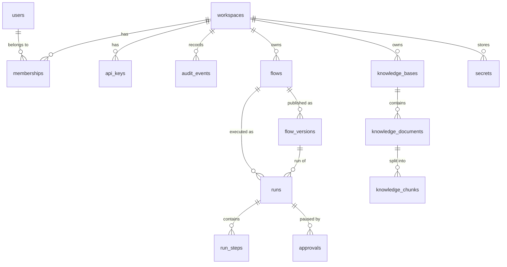
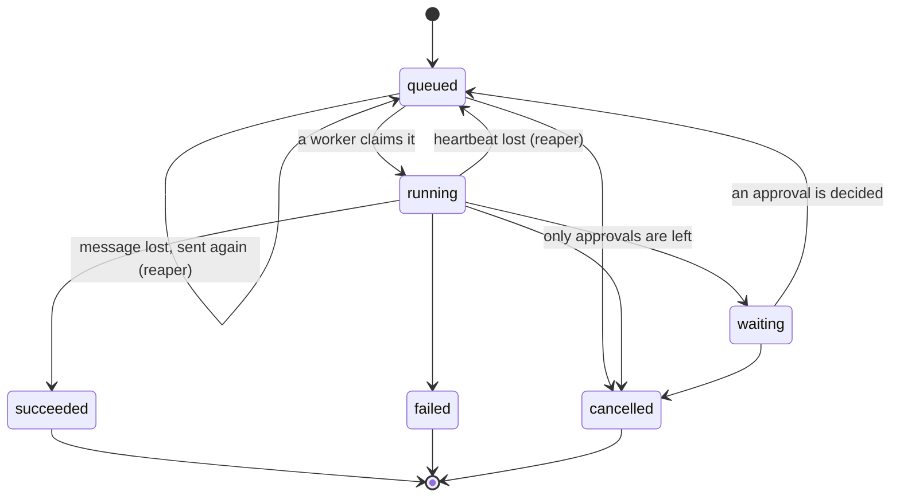

# Data model

The schema is managed by Alembic (`apps/api/src/agentstudio/migrations/versions`) and applied
by `agentstudio migrate` (or the `migrate` one-shot container) under a Postgres advisory
lock. The SQLAlchemy models in `apps/api/src/agentstudio/models` mirror it.

## Conventions

| Convention | Why |
| --- | --- |
| Primary keys are UUID version 7, generated in the API (`core/ids.py`) | Time-ordered keys keep inserts at the right edge of each B-tree, so hot index pages stay cached as `runs` and `run_steps` grow; they are also safe to expose |
| Every timestamp is `timestamptz` and the API runs in UTC | No ambiguity across regions or daylight saving |
| Enumerations are `varchar` with a named `CHECK` constraint | Adding a value is a one-line migration, unlike altering a Postgres enum type |
| `citext` for emails | Case-insensitive uniqueness without `lower()` everywhere |
| JSONB for documents the engine owns (graphs, inputs, outputs, step payloads, settings) | They are read and written whole, validated by Pydantic at the edge, and never queried by inner fields on hot paths |
| Every workspace-owned table carries `workspace_id` with `ON DELETE CASCADE` | Isolation is a column, not a join, and deleting a workspace removes everything it owns |
| Constraint and index names follow one naming convention (`db/base.py`) | Hand-written migrations and autogenerated diffs agree |
| Lists paginate with `limit` and `offset` over an index that matches their order | Every list endpoint has a supporting index (listed below) |

Extensions: `citext`.

## Tables

### Identity and access

**`users`**

| Column | Type | Notes |
| --- | --- | --- |
| `id` | uuid | primary key |
| `email` | citext | unique |
| `name` | varchar(120) | |
| `password_hash` | text | Argon2id |
| `is_admin` | boolean | instance administrator (the first account) |
| `session_version` | integer | embedded in session tokens; bumping it signs the user out everywhere |
| `failed_logins`, `locked_until` | integer, timestamptz | lockout after repeated failures |
| `last_login_at`, `created_at`, `updated_at` | timestamptz | |

**`workspaces`**: `id`, `slug` (varchar(64), unique), `name`, `description`, `settings`
(jsonb: default model, run retention), `created_by` (users, set null), `created_at`,
`updated_at`.

**`memberships`**: primary key `(workspace_id, user_id)`, `role` (`owner`, `editor`,
`viewer`), `created_at`. Index on `user_id` (the "my workspaces" query).

**`api_keys`**: `id`, `workspace_id`, `created_by`, `name`, `prefix` (unique, the lookup key),
`secret_hash` (HMAC-SHA256 with the server pepper), `role` (`editor` or `viewer`),
`last_used_at`, `expires_at`, `revoked_at`, `created_at`. Index on `workspace_id`.

**`audit_events`**: `id`, `workspace_id`, `actor_user_id`, `actor_api_key_id`, `action`
(for example `flow.published`, `approval.decided`, `secret.updated`), `target_type`,
`target_id`, `details` (jsonb), `created_at`. Index `(workspace_id, created_at)`.

### Flows

**`flows`**

| Column | Type | Notes |
| --- | --- | --- |
| `id` | uuid | primary key |
| `workspace_id` | uuid | workspaces, cascade |
| `name` | varchar(120) | |
| `description` | text | |
| `tags` | varchar(32)[] | GIN index for tag filters |
| `graph` | jsonb | the draft graph document |
| `draft_revision` | integer | optimistic concurrency: a save names the revision it was based on |
| `draft_updated_at`, `draft_updated_by` | timestamptz, uuid | |
| `published_version_id` | uuid | flow_versions, set null; the version webhooks and API calls run |
| `latest_version` | integer | the highest version number issued |
| `webhook_id` | varchar(32) | unique, nullable: the public hook path segment |
| `webhook_secret` | bytea | AES-256-GCM ciphertext of the signing secret |
| `webhook_enabled` | boolean | |
| `template_slug` | varchar(64) | the template the flow was created from, if any |
| `last_run_at`, `last_run_status` | timestamptz, varchar(16) | denormalised for the flow list, updated when a run finishes |
| `created_by`, `created_at`, `updated_at` | | |

Indexes: `(workspace_id, updated_at)` for the flow list; GIN on `tags`.

**`flow_versions`**: `id`, `flow_id` (cascade), `workspace_id`, `version` (integer, unique
per flow), `graph` (jsonb, immutable), `graph_sha256`, `notes`, `created_by`, `created_at`.
Unique `(flow_id, version)` also serves the version list.

### Runs

**`runs`**

| Column | Type | Notes |
| --- | --- | --- |
| `id` | uuid | primary key |
| `workspace_id`, `flow_id` | uuid | cascade |
| `flow_version_id` | uuid | the version run; null for a draft run |
| `version` | integer | the version number, 0 for the draft |
| `graph` | jsonb | snapshot of the draft for draft runs (versions are immutable, so version runs do not copy it) |
| `status` | varchar(16) | `queued`, `running`, `waiting`, `succeeded`, `failed`, `cancelled` |
| `trigger` | varchar(16) | `manual`, `api`, `webhook`, `rerun` |
| `inputs`, `outputs`, `error` | jsonb | |
| `prompt_tokens`, `completion_tokens` | integer | totals over every step |
| `cost_usd` | numeric(14, 6) | total cost |
| `cost_simulated` | boolean | true when any cost came from the offline provider's simulated price |
| `step_count` | integer | |
| `triggered_by_user_id`, `triggered_by_api_key_id` | uuid | set null |
| `rerun_of_id` | uuid | runs, set null |
| `claims` | integer | how many times a worker has claimed it (first run plus resumes) |
| `heartbeat_at` | timestamptz | refreshed every 15 seconds while running |
| `enqueued_at` | timestamptz | when the run was last put on the queue (start, approval decision, hand-back, re-queue) |
| `cancel_requested_at` | timestamptz | |
| `created_at`, `started_at`, `finished_at` | timestamptz | `created_at` is the queue time |
| `duration_ms` | integer | |

Indexes: `(workspace_id, created_at)` for run history, `(flow_id, created_at)` for a flow's
runs, `(workspace_id, status, created_at)` for status filters, and two small partial indexes
for the reaper: `heartbeat_at WHERE status = 'running'` (runs whose worker vanished) and
`enqueued_at WHERE status = 'queued'` (runs whose queue message was lost).

**`run_steps`**

| Column | Type | Notes |
| --- | --- | --- |
| `id` | uuid | primary key |
| `run_id` | uuid | runs, cascade |
| `workspace_id` | uuid | denormalised so step queries filter by workspace directly |
| `node_id`, `node_type`, `label` | varchar | |
| `iteration` | varchar(64) | `''` at the top level, `'3'` inside a loop, `'3/1'` in a nested loop |
| `seq` | integer | start order within the run |
| `status` | varchar(16) | `running`, `succeeded`, `failed`, `skipped`, `waiting`, `cancelled` |
| `attempt` | integer | 1 plus retries |
| `input`, `output`, `error` | jsonb | masked and size-capped |
| `events` | jsonb | tool calls, retries and model calls, in order |
| `handles` | jsonb | the output handles that fired |
| `model` | varchar(120) | for model steps |
| `prompt_tokens`, `completion_tokens` | integer | |
| `cost_usd` | numeric(14, 6) | |
| `cached` | boolean | served from the response cache |
| `continued` | boolean | failed with `continue_on_error`, so the flow went on |
| `started_at`, `finished_at` | timestamptz | |
| `latency_ms` | integer | |

Unique `(run_id, node_id, iteration)`; index `(run_id, seq)` for the inspector.

**`approvals`**: `id`, `workspace_id`, `run_id` (cascade), `flow_id` (cascade), `node_id`,
`title`, `message`, `context` (jsonb: what the reviewer needs), `status` (`pending`,
`approved`, `rejected`, `expired`, `cancelled`), `expires_at`, `decided_by` (users, set null),
`decided_at`, `comment`, `created_at`. Unique `(run_id, node_id)`. Indexes: a partial index on
`(workspace_id, created_at) WHERE status = 'pending'` for the inbox and a partial index on
`expires_at WHERE status = 'pending'` for the reaper.

### Knowledge

**`knowledge_bases`**: `id`, `workspace_id`, `name` (unique per workspace), `description`,
`document_count`, `chunk_count`, `created_by`, `created_at`, `updated_at`.

**`knowledge_documents`**: `id`, `knowledge_base_id` (cascade), `workspace_id`, `title`,
`filename`, `content_type` (`text/plain` or `text/markdown`), `size_bytes`, `sha256` (unique
per knowledge base: the same file uploaded twice is one document), `storage_key`,
`chunk_count`, `token_count`, `created_by`, `created_at`.

**`knowledge_chunks`**: `id`, `document_id` (cascade), `knowledge_base_id`, `workspace_id`,
`ordinal`, `heading` (the Markdown heading path), `text`, `token_count`, and `tsv`, a stored
generated column `to_tsvector('english', heading || ' ' || text)`. Unique
`(document_id, ordinal)`; GIN index on `tsv`; index on `knowledge_base_id`.

### Secrets

**`secrets`**: `id`, `workspace_id`, `name` (`^[A-Z][A-Z0-9_]{0,63}$`, unique per workspace),
`description`, `ciphertext` (bytea: AES-256-GCM, nonce prepended, the workspace id and name
bound as associated data so a ciphertext cannot be moved to another row), `created_by`,
`updated_by`, `created_at`, `updated_at`, `last_used_at`.

## Relationships

## Run and step states

A step is `running` while it executes, `waiting` while its approval is pending, and ends
`succeeded`, `failed`, `skipped` or `cancelled`.

## Redis keys

| Key | Type | Lifetime | Purpose |
| --- | --- | --- | --- |
| `run:{id}:events` | stream (MAXLEN about 5000) | 7 days, shortened to 24 hours when the run finishes | the run's trace events, read by SSE with `XREAD` |
| `run:{id}:cancel` | string | 1 hour | cancel flag polled by the executor |
| `rl:{bucket}:{principal}:{window}` | counter | one window | fixed-window rate limits |
| `session:revoked:{jti}` | string | until the token expires | single-session sign-out |
| `apikey:touched:{id}` | string | 60 seconds | write `last_used_at` at most once a minute |
| `llm:{sha256}` | string | the node's `cache_ttl_s` | model response cache |
| `dash:{workspace_id}` | string | 30 seconds, deleted when a run finishes | dashboard aggregates |
| `hook:seen:{sha256}` | string | 10 minutes | webhook replay protection |
| `lock:reaper` | string | 25 seconds | elects the worker that reaps stale runs and expired approvals |

## Queue messages

SQS body: `{"run_id": "<uuid>", "workspace_id": "<uuid>"}`. The run row is the truth; the
message only says "look at this run". A malformed message is deleted and logged. After ten
receives (`max_receive_count` in `infra/terraform/modules/queues`) SQS moves a message to
the dead-letter queue, and an alarm fires.

## Object storage keys

`workspaces/{workspace_id}/knowledge/{knowledge_base_id}/{document_id}/original.{md|txt}`,
generated by the server, never taken from a file name.
