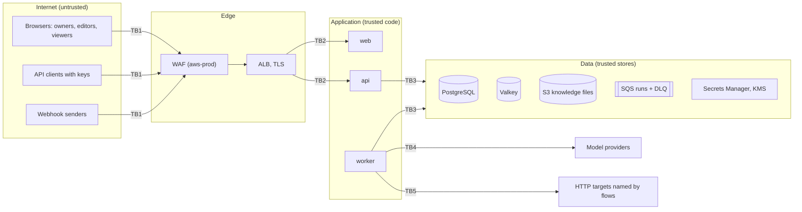

# Threat model

This is a STRIDE analysis of Euron AgentStudio as deployed by the Terraform in
`infra/terraform` (the `aws-prod` environment) with the defaults in the code. Each row names
the threat, the control that exists today and what remains. The controls themselves are
described in [security.md](security.md); the decisions behind them are in the
[ADRs](adr/README.md).

Residual risks are stated plainly. Where the residual is "accepted" it is a design choice;
where it is "open" it is a known gap.

## Scope and trust boundaries

| Boundary | Crossing |
| --- | --- |
| TB1 | Public internet to the edge: every request is untrusted, including signed webhooks until verified |
| TB2 | Edge to tasks: TLS ends at the load balancer; tasks run in private subnets with no public IP; the worker has no inbound path at all |
| TB3 | Tasks to their stores: IAM task roles, security groups, TLS to RDS and Valkey |
| TB4 | Worker to model providers: rendered prompts leave the deployment (nothing leaves with the offline model) |
| TB5 | Worker to HTTP targets: destinations come from flow settings and run inputs, so they pass the outbound network guard |
| Logical | Workspace to workspace; role to role inside a workspace; model output to tool calls (untrusted text choosing tool arguments) |

## Assets, ranked

| Rank | Asset | Why it ranks here |
| --- | --- | --- |
| 1 | Workspace secrets (`secrets.ciphertext`): third-party API tokens that flows use | Each one acts in someone else's system with real authority |
| 2 | Key material: `ENCRYPTION_KEY`, `SESSION_SECRET`, `API_KEY_PEPPER`, provider API keys, the database password, the Valkey auth token | Each one decrypts rank 1, forges sessions, validates keys or reaches a store directly |
| 3 | The worker's network position | Inside the VPC, next to the database, the cache and the cloud metadata service; server-side request forgery turns flows into a proxy |
| 4 | Owner accounts, sessions and API keys | Full authority over a workspace: members, secrets, keys, every flow |
| 5 | Run data and knowledge documents: inputs, outputs, step payloads, approvals, uploaded files | Often customer data (support tickets, invoices, contacts) |
| 6 | Integrity of the actions flows take: HTTP requests with side effects and the approvals gating them | A forged or unreviewed run can change records in other systems |
| 7 | Flow definitions, prompts and published versions | Intellectual property; what production webhooks run |
| 8 | Activity log | Accountability for changes and decisions |
| 9 | Model spend and worker capacity | Provider bills; runs other workspaces wait on |
| 10 | Terraform state | Holds the generated application secrets |

## Spoofing

| Threat | Mitigation | Residual |
| --- | --- | --- |
| Password guessing | Argon2id; 10 sign-ins a minute per client IP counted in Valkey (shared by every API task); eight failures lock the account for 15 minutes; the client IP comes from `X-Forwarded-For` only when the hop is the load balancer (`FORWARDED_ALLOW_IPS`) | No multi-factor authentication and no self-service password reset (open, roadmap). The lockout can be triggered on purpose to keep someone out for 15 minutes (accepted). |
| Claiming a fresh deployment | Until the first account exists, the sign-up page accepts exactly one sign-up; the deploy guide creates that account with the CLI right after the rollout | Whoever signs up first on a new, empty deployment owns it; the window lasts until the operator creates the first account (accepted, documented). The CLI prints a generated password into the one-off task's log group when no terminal is attached; it is useless once changed (accepted). |
| Account enumeration | Unknown emails are checked against a dummy hash, and every wrong email or password returns the same message | A locked account answers differently, so eight wrong attempts reveal that an email has an account, and sign-up with `ALLOW_SIGNUP=true` reports a taken email (accepted; both are slowed by the per-IP limit, and sign-up is off by default). |
| Stolen session | `httpOnly` cookie that scripts cannot read, `SameSite=Lax`, `Secure` in production, 7-day expiry; sign-out puts the token id on a denylist; a password change revokes every other session | The web app sets no Content-Security-Policy, so an injected script could act as the user while the page is open (open). "Sign out everywhere" exists only as a password change (accepted). |
| Forged session token | HS256 with `SESSION_SECRET` (32+ characters, checked at boot), issuer and audience checked, the user's session version must match | Anyone holding `SESSION_SECRET` can mint a session for any user (see rank 2). |
| Stolen API key | Stored only as an HMAC under `API_KEY_PEPPER`; shown once; bound to one workspace; `viewer` or `editor` only; optional expiry; revocable; last use shown | A key is a bearer credential with no IP restriction, and a key without an expiry lives until revoked (open: no enforced maximum lifetime). |
| Forged webhook | HMAC-SHA256 over timestamp and raw body with the flow's own secret, constant-time comparison, five-minute window, replay guard for twice that window; unknown, disabled and secretless hooks are indistinguishable | Whoever holds the signing secret can start runs; rotation is one click and invalidates the old secret at once (inherent to shared-secret webhooks). |
| Cross-site request forgery | Unsafe methods on a cookie session need an `Origin` or `Referer` from `CORS_ORIGINS` or `WEB_URL`; `SameSite=Lax`; every `GET` is read-only | None identified. |
| A machine approves its own run | Approval decisions require a signed-in person; API keys are refused | The person who started a run, or built the flow, may approve it; there is no four-eyes rule (open, roadmap). |

## Tampering

| Threat | Mitigation | Residual |
| --- | --- | --- |
| Cross-workspace writes by id | The workspace is resolved per request from the path and the caller's membership; every repository query filters by workspace; an integration test sweeps every workspace route with an outsider's session and with another workspace's key | Application-level only; there is no row-level security in Postgres (open). |
| Lost edits between two editors | Every draft save carries the revision it was based on; a stale save is refused with `revision_conflict` | n/a |
| Changing what production runs | Webhooks always run the published version and API runs default to it (`auto` falls back to the draft only for a flow never published); versions are immutable; publishing and restoring are audited | Any editor can publish (by design). |
| A ciphertext moved to another row or workspace | AES-256-GCM associated data binds each value to its workspace and name, and each webhook secret to its flow | None identified. |
| Forged or replayed queue messages | Messages carry only a run id; a worker claims a run with a conditional update, so duplicates and replays are ignored; IAM limits sending to the task roles | A principal with `sqs:SendMessage` can only nudge runs that already exist (accepted). |
| Code injected into an exported script | Every user string is a `repr()` literal, comments are one sanitised line, identifiers come from validated node ids; a test exports hostile strings and inspects the parsed script | An exported script is code people run on their own machines; review it like any download (inherent). |
| Direct database modification | RDS in private subnets, `rds.force_ssl`, the password only in Secrets Manager, security groups per consumer | The application connects as the RDS master user, so a compromised task has full DDL and DML rights (open). |
| Supply-chain tampering | Locked dependencies (`uv.lock`, `pnpm-lock.yaml`), pinned base images, immutable ECR tags, scan on push, `make sanitize` and gitleaks in CI | No image signing (open). |
| Tampering in transit | TLS 1.2+ at the load balancer, HTTP redirected; TLS to RDS and Valkey | Load balancer to task traffic is plain HTTP inside private subnets (accepted). |

## Repudiation

| Threat | Mitigation | Residual |
| --- | --- | --- |
| A member denies a change | The activity log records the person or API key behind flow creation, edits of name and tags, publishing, restores, imports, duplicates and deletes, member and role changes, secrets, API keys, webhooks, knowledge changes, approval decisions and expiries, and cancellations; every run records what triggered it and who | Draft autosaves and sign-ins are not activity entries (structured logs only). The log lives in the same database and is writable by the application role; it is not tamper-evident (open). |
| A reviewer denies a decision | Approvals store who decided, when and the comment; the decision is also an activity entry | n/a |
| A request cannot be traced | Every response carries `X-Request-Id`, which every log line and error body repeats | Load balancer access logs are opt-in (`access_logs_bucket`) and WAF logging is not configured by the modules (open). |

## Information disclosure

| Threat | Mitigation | Residual |
| --- | --- | --- |
| Reading another workspace's data | As for tampering; non-members get `404`, never `403`; model response caches are keyed by workspace, so a cached answer never crosses tenants | As for tampering. |
| A secret value through the API | Values are never returned; every resolved value is replaced with `[secret:NAME]` in step inputs, outputs, errors, live events and the run's own outputs and error | Anyone who can use a secret in a flow can read it on purpose, for example by sending it to a host they control or transforming it before output. Secrets are workspace-wide, so every editor can use every secret (accepted for editors; per-flow scoping is on the roadmap). |
| Server-side request forgery | Connect-time address checks refuse loopback, private, link-local, CGNAT, multicast, reserved and metadata addresses; at most three redirects, each checked; only `http` and `https`; capped responses | Hosts in `HTTP_ALLOWED_HOSTS` are reachable from every workspace (the allowlist is deployment-wide; keep it short). |
| Prompt injection exfiltrates data | No tool runs code; agents call only the tools wired to them, HTTP tools still go through the guard; Human approval can gate any action | An agent can send what its run can see to wherever its tools' URL templates allow; fix the host in tool URLs and add an approval before side effects (accepted, documented). |
| Prompts sent to a model provider | The offline model keeps everything in process; hosted providers are opt-in per deployment and named per node | With a hosted provider, rendered prompts leave the deployment (accepted per deployment). |
| Secrets or tokens in logs | structlog redacts fields named like passwords, secrets, tokens, authorization headers, API keys and cookies; webhook bodies and model responses are not logged | Redaction is by field name; a new field carrying a secret under another name would be logged (process control). |
| Internals in error messages | Unexpected errors return a generic message with the request id; details stay in the logs | None identified. |
| Operational metrics | `/metrics` is answered with 404 at the load balancer; locally every port binds to `127.0.0.1` | None identified. |
| Leaked database dump or backup | RDS storage, snapshots, S3 objects, queues and logs are encrypted with the deployment's KMS key; secrets are additionally sealed with `ENCRYPTION_KEY` | Run payloads and knowledge text are readable by anyone who can read the database (they are not field-encrypted). Runs are kept until their flow or workspace is deleted; there is no retention policy yet (open, roadmap). |
| Data left after deletion | Deleting a workspace or knowledge base deletes its rows and its stored files | A file whose deletion fails is logged and left behind; backups keep data until their retention ends (open, documented). |
| Exported flows | JSON and Python exports contain secret names, never values; scripts read values from `SECRET_<NAME>` variables | Prompts and settings are in the export by design. |
| Terraform state | `backend.tf.example` sets up a private, versioned, encrypted state bucket | Local state on a laptop holds the generated secrets in plain text (operator responsibility). |

## Denial of service

| Threat | Mitigation | Residual |
| --- | --- | --- |
| Request floods | WAF per-IP rate rule (on in `aws-prod`); per-caller limits on starting runs (60 a minute), uploads (60), the offline model (600), sign-in (10 per IP) and webhooks (120 per hook); API autoscaling on CPU | `aws-dev` runs without the WAF. The `/sandbox` fixture API is public, stateless and limited only by the WAF (accepted). |
| Large bodies | Request bodies capped before parsing; webhooks 256 KB; graphs 512 KB, 200 nodes, 400 edges; documents 2 MB; recorded step payloads 256 KB | n/a |
| Runaway runs | Run timeout (15 minutes), per-step timeouts and bounded retries, at most 200 loop items, 10 agent iterations, 4 parallel steps per run, 20 active runs per workspace; waiting runs hold no worker slot | One workspace can use worker slots up to its active-run cap; there is no fair scheduling between workspaces (open). |
| Runaway model spend | `max_tokens` per node, the agent iteration cap, the response cache, cost per run on the dashboard | No spend budget per workspace or per flow (open, roadmap). |
| Poison runs | A message is retried ten times, then dead-lettered; a run is failed after five claims; alarms on dead letters and queue age | n/a |
| Expensive expressions | Regular expressions run on RE2 (linear time); the calculator walks an AST with limits; JSON transforms run on capped payloads | None identified. |
| Lockout as a weapon | 15-minute lock, then automatic unlock | See spoofing. |

## Elevation of privilege

| Threat | Mitigation | Residual |
| --- | --- | --- |
| A viewer acts as an editor, an editor as an owner | Every route declares its minimum role, checked by one dependency before the handler runs; role behaviour is covered by integration tests per resource | Coverage depends on each route declaring the right dependency (process control: review new routes). |
| An API key does more than its role | Keys are `viewer` or `editor` only, bound to one workspace; managing keys, members and secrets needs an owner session; approval decisions need a person | None identified. |
| Code execution through a flow | There is no code node: templates are paths and fixed filters, conditions are a closed operator list, arithmetic is an AST evaluator, transforms are JMESPath | None identified. |
| Code execution through an upload | Only `.md`, `.markdown` and `.txt` files are accepted and treated as text; there is no document parser to exploit | n/a |
| The last owner leaves | Removing or demoting the last owner is refused (`last_owner`) | n/a |
| A compromised task abuses AWS | The task policy grants only the database secret, the knowledge prefix, the run queues and KMS through those services | A compromised task can read every workspace's data (it must, to serve requests). |
| Container escape or persistence | Non-root user, read-only root filesystem, no public IP, ECS Exec disabled | Standard Fargate isolation is relied upon (accepted). |

## Review triggers

Revisit this document when any of these change: a new public (unauthenticated) route, a new
node type or tool, a new model provider, a change to how secrets are resolved or recorded,
token lifetimes or storage, the outbound network guard, or the role model.
